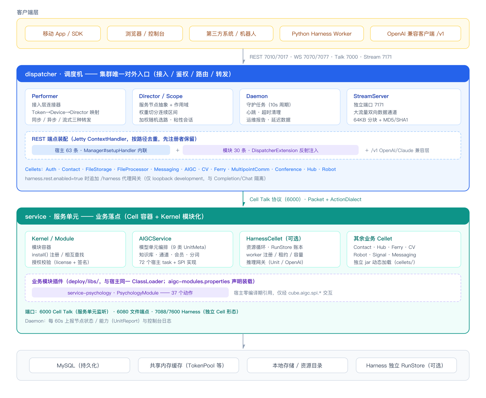
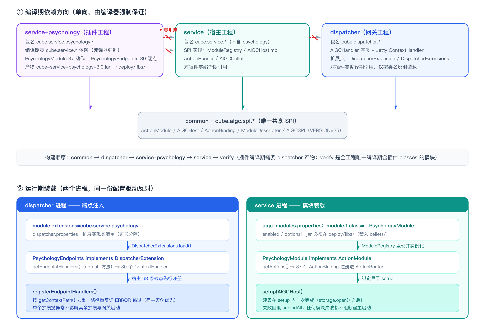
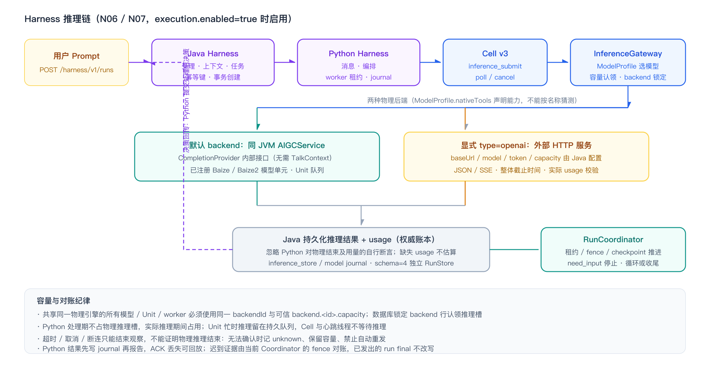

# Cube Harness Engineering

**Cube Harness Engineering** 是一个面向 AIGC 与实时协作场景的服务端工程。它由**调度机（dispatcher）**、**服务单元（service）**与可选的**资源执行单元（service-harness）**构成，把「提示词模板 + 策略」的编排能力（Harness）嵌入到从网关到业务单元的完整链路上：任意环节都可以加载模板、附加策略、调用知识库，并对推理过程进行审计与热部署。

工程的三条主线：

- **网关与业务分离** —— dispatcher 只做接入、鉴权、路由与转发，不承载任何业务逻辑；业务全部落在 service。
- **业务模块插件化** —— 业务能力（如心理学）以独立工程、独立 jar 的 AIGC Module 形态装载，宿主与网关对插件**零编译期引用**，本文以 [`service-psychology`](#六插件开发以-service-psychology-为例) 为例完整说明插件开发方式。
- **Harness 机制** —— 提示词模板、策略、SKILL 技能、向导流与提示词编排构成一套可热更新的「行为指令」体系，让模型按既定规范作答。

---

## 目录

- [一、项目概览](#一项目概览)
- [二、整体架构](#二整体架构)
- [三、工程结构](#三工程结构)
- [四、调度机 dispatcher](#四调度机-dispatcher)
- [五、服务单元 service](#五服务单元-service)
- [六、插件开发：以 service-psychology 为例](#六插件开发以-service-psychology-为例)
- [七、Harness Engineering 机制](#七harness-engineering-机制)
- [八、service-harness：资源执行单元](#八service-harness资源执行单元)
- [九、配置说明](#九配置说明)
- [十、构建、验证与部署](#十构建验证与部署)
- [十一、开发指引](#十一开发指引)
- [许可证](#许可证)

---

## 一、项目概览

| 组件 | 工程目录 | 形态 | 职责 |
| --- | --- | --- | --- |
| 调度机 | `dispatcher/` | 独立进程 | 集群唯一对外入口：连接接入、鉴权、路由分发、并发控制，暴露 REST/HTTP、WebSocket 与 Cell Talk 协议 |
| 服务单元 | `service/` | 独立进程 | 业务落点：Cell 容器 + Kernel 模块化结构，承载 AIGC、联系人、文件、协同、机器人等能力 |
| 资源执行单元 | `service-harness/` | 可选 Cellet | 资源循环与推理编排：worker 注册、RunStore 账本、模型调度，配套 Python Harness |
| 业务模块 | `service-psychology/` | 插件 jar | 心理学业务模块（AIGC Module 形态）：37 个业务动作 + 30 个 REST 端点 |
| 公共库 | `common/` | jar | 协议包、实体模型、动作枚举、模块 SPI（`cube.aigc.spi.*`）、存储与工具 |
| 控制台 | `console/` | Web | 管理界面：管理/监视多个服务节点 |
| 应用服务器 | `server-app/` | 独立进程 | 应用型服务入口（基于 `cube.client.*` SDK） |
| 摆渡服务 | `ferryboat/`、`ferryhouse/` | 独立进程 | 跨域消息摆渡与工作区 |
| 集成验证 | `verify/` | 测试工程 | 模块装载与插件契约的集成验证（全工程唯一编译期可同时引用插件与宿主的模块） |
| 独立服务 | `service-messaging/` 等 6 个 | jar | 以 jar 形式动态加载的独立服务单元（`deploy/cellets/`） |

**技术栈**：Java SE 8（硬性前提，工程使用 Nashorn 执行向导流脚本）、Jetty 9.4（HTTP/WS）、Ant 构建、MySQL 持久化、共享内存缓存、Vue 3 控制台前端。

---

## 二、整体架构



```
客户端 ──REST 7010/7017 · WS 7070/7077 · Talk 7000 · Stream 7171──▶ dispatcher
                                                                      │ Cell Talk 6000
                                                                      ▼
                                                                  service ──▶ MySQL / 缓存 / 存储
```

**一次请求的生命周期**（以 REST 为例）：

1. 客户端请求到达 dispatcher 的 Jetty 上下文，端点处理器（宿主内联或模块注入）先做令牌/设备鉴权；
2. `Manager#syncRequest` 把动作打包为 `Packet` + `ActionDialect`，经 `Performer` **同步转发**给服务单元（默认超时 90s）；
3. 服务单元 `AIGCCellet` 收到请求，`ActionRouter` 先查已装载的业务模块，未命中再回退宿主自身的 `task/` 分支；
4. 业务处理（模型单元、知识库、模板策略）完成后，应答经 `sn` 映射回送网关，网关投递给原始客户端。

**部署形态**：单体部署（全部组件同机）或集群部署（多 service 节点注册为 `director.N`，网关按权重切分区间做负载均衡，扩容无需重启客户端）。`Dockerfile` 提供基于 `cubestack/jdk1.8` 的容器化构建。

---

## 三、工程结构

```
cube-server/
├── dispatcher/                   # 调度机（网关）
│   └── src/cube/dispatcher/
│       ├── DispatcherListener    # 容器监听器：装载配置、构建 Performer
│       ├── Performer             # 接入层连接器：路由、转发、流
│       ├── Director / Scope      # 路由节点与作用域（权重）
│       ├── Daemon                # 守护任务：心跳 / 超时 / 报告
│       ├── stream/               # StreamServer 大流量通道
│       ├── aigc/                 # AIGC 接口管理器 + 通用 REST 处理器（宿主 63 个端点）
│       │   ├── completion/       # OpenAI / Claude 兼容层（/v1）
│       │   ├── handler/          # 通用 REST 处理器（45 个）+ app/ 应用层（18 个）+ ModuleAction 兜底通道
│       │   └── spi/              # 业务模块 SPI：DispatcherExtension + 装载器
│       ├── harness/              # Harness 代理网关（harness.rest.enabled 显式启用）
│       ├── contact/ filestorage/ fileprocessor/ messaging/ multipointcomm/
│       ├── conference/ ferry/ hub/ cv/ robodroid/ auth/ riskmgmt/ signal/
│       ├── assets/               # 分享页、App 页、图表、水印等静态资源
│       └── config/dispatcher.properties
│
├── service-psychology/           # 心理学业务模块（插件 jar，编译期依赖 dispatcher）
│   └── src/cube/service/psychology/
│       ├── PsychologyModule            # 模块入口：描述符、动作绑定、装载与卸载
│       ├── PsychologyStorage           # 模块私有存储（建表在 setup 内一次完成）
│       ├── action/                     # 37 个动作处理器，一动作一类
│       ├── scene/                      # 业务场景：咨询、副驾、语音流、报告生成
│       ├── evaluation/                 # 评测与综合报告
│       ├── dataset/                    # 量表 / 问卷数据集
│       ├── dispatcher/PsychologyEndpoints   # 向网关注入 30 个 REST 端点
│       └── dispatcher/handler/         # 30 个端点实现（继承网关 AIGCHandler）
│
├── service/                      # 服务单元（业务）
│   └── src/cube/service/
│       ├── ServiceCarpet         # 容器监听器：授权校验、内核装配
│       ├── Daemon                # 守护任务：状态报告、日志上报
│       ├── aigc/                 # ★ AIGC 平台能力（154 个源文件）
│       │   ├── AIGCService       # 服务门面（约 3400 行）
│       │   ├── unit/             # 9 类模型单元元数据 + 队列执行器
│       │   ├── knowledge/        # 知识库框架（Graph RAG 数据侧骨架）
│       │   ├── task/             # 72 个宿主任务
│       │   ├── completion/       # ChatCompletionService（复用 Completion 鉴权/队列/用量）
│       │   ├── guidance/         # 向导流（Nashorn 脚本）
│       │   ├── listener/         # 13 个异步结果回调监听器
│       │   ├── plugin/           # 7 个能力挂接插件
│       │   ├── spi/              # 模块 SPI 实现：ModuleRegistry / AIGCHostImpl / ActionRunner
│       │   └── channel/ member/ event/ module/ resource/ utils/ command/
│       ├── auth/ contact/ client/ hub/ ferry/ robodroid/ cv/ signal/
│       ├── assets/               # 提示词模板、策略、向导流、问卷、技能、脚本模组
│       ├── config/               # 服务配置、存储配置、模块声明
│       └── lib/                  # 本地动态库
│
├── service-harness/              # 资源执行单元（可选，N00–N07）
│   ├── src/cube/service/harness/ # protocol / store / execution / runtime 等 34 个源文件
│   ├── test/                     # 7 个测试（不进入正式 jar）
│   ├── contracts/                # 跨语言契约（Java/Python 逐字节镜像）
│   ├── config/ scripts/ resources/
│   └── README.md CONTRACT.md RUNTIME.md STORE.md EXECUTION.md   # 模块详细文档
│
├── verify/                       # 集成验证：ModuleRegistryLoadTest（44 断言）+ PsychologyPluginTest（162 断言）
├── common/                       # 公共库：协议、实体、动作（AIGCAction 126 个常量）、模块 SPI、存储、工具
├── console/                      # 控制台 Web（Vue，端口 7080）
├── server-app/                   # 应用服务器
├── ferryboat/ ferryhouse/        # 摆渡服务与工作区
├── deploy/                       # 部署产物与启停脚本（libs/ 同 ClassLoader，cellets/ 独立加载）
├── docs/images/                  # 文档架构图（PNG 渲染版 + SVG 可编辑源件）
├── build.xml / Makefile          # Ant 构建入口
├── compile-check.sh              # 5 段全量编译验证（common → dispatcher → 插件 → service → verify）
└── Dockerfile                    # 容器化构建
```

---

## 四、调度机 dispatcher

调度机是整个集群的**唯一对外入口**。它不承载业务逻辑，只做三件事：**接入、路由、转发**，并按 Cellet 粒度做加权负载均衡。

### 4.1 核心组件

| 类 | 作用 |
| --- | --- |
| `DispatcherListener` | Cell 容器监听器。读取 `config/dispatcher.properties`，注册 Cellet 清单与 `director.N.*` 路由节点，配置 HTTP/WS/SSL 服务；容器初始化时启动 `Performer`，并以 10 秒周期调度 `Daemon` |
| `Performer` | 接入层连接器。持有 Director 路由表、`Token→Device`、`TalkContext→Director`、`Token→Director`、在线联系人、转发记录、阻塞记录等运行时状态；实现 `TalkListener` 接收服务单元回送数据 |
| `Director` | 一个服务节点（导演机）的抽象，含业务 Endpoint、文件 Endpoint、`Scope` 与可发言的 `Speakable` |
| `Scope` | 节点作用域：该节点承载的 Cellet 名称列表 + 权重（1–10，默认 5） |
| `DispatcherTask` | 调度任务抽象，封装 `Packet`/`ActionDialect` 解析与统一的响应打包（`state`/`data`/`code`） |
| `Daemon` | 守护任务：驱动 `onTick`、清理失效会话上下文、清理超时转发记录、生成运维报告与延迟数据 |
| `StreamServer` | 独立端口（默认 7171）的数据流服务器，承载大流量双向数据传输 |
| `HarnessGateway` | 可选的 `/harness` 代理网关（`harness.rest.enabled=true` 显式启用，仅 loopback development） |

### 4.2 路由与负载均衡

路由表在 `Performer.start()` 中一次性构建为**按权重切分的连续区间**：

```
某 Cellet 的候选节点：  D1(weight=5)      D2(weight=3)      D3(weight=2)
                        ├────────────┤├──────────┤├──────┤
区间（anchor）          0            4 5         7 8      9
                        └──── totalWeight = 10 ────┘
```

- 每个 `Director.Section` 记录 `begin` / `end` / `totalWeight`；
- 选路时在 `[0, totalWeight-1]` 内取随机整数作为 anchor，落入哪个区间就选哪个节点，实现**加权随机**；
- 连接一旦选中节点即写入 `talkDirectorMap` / `tokenDirectorMap`，后续同一会话/令牌保持**粘性路由**，避免跨节点状态漂移；
- 无候选节点时回退到列表首节点；无会话上下文时按**最大权重节点**选取。

### 4.3 转发模型

| 语义 | 方法 | 说明 |
| --- | --- | --- |
| 异步转发 | `transmit(...)` | 发送后立即返回。基于 `Transmission` 记录 `sn → Cellet + TalkContext`，服务单元回送时按 `sn` 找回原始客户端连接并投递 |
| 同步转发 | `syncTransmit(...)` | 发送后基于 `Block` 阻塞当前线程，以 50ms 间隔轮询应答，默认超时 30s（AIGC 接口管理器使用 90s）。超时返回 `null` 并记录 `Service timeout` |
| 流式转发 | `transmit(..., InputStream)` | 通过 `speakStream` 把输入流以 64KB 分块推送到服务单元，可同时计算 MD5/SHA1 摘要 |

### 4.4 转发标记：P-KEY 与 D-KEY

跨节点通信依赖两个私有参数，在 `dispatcher` 与 `service` 两侧成对定义：

- **`_performer`（P-KEY）**：调度机写入，内容为 `{sn, ts}`。服务单元回送应答时原样带回，`Performer.onListened` 依此将数据路由回发起方。
- **`_director`（D-KEY）**：服务单元写入（`cube.service.Director.attachDirector`），内容为 `{id, domain, device?}`。调度机收到后查找在线联系人：未指定 device 则**广播到该联系人的所有在线设备**，指定 device 则**定向投递**。

### 4.5 对外接口

**① REST / HTTP（默认 7010 / 7017）**

AIGC 相关端点共 **93** 条，由两条来源装配，全部经 `Manager#setupHandler()` 注册到 Jetty 上下文：

- **宿主端点（63 条）** —— 内联注册，覆盖 NLP、多模态、语音基础能力、知识库、应用层、运维与文档等平台能力；
- **业务模块端点（30 条）** —— 由模块插件经 `DispatcherExtension` 提供，网关在**自身端点之后**按 `getContextPath()` 去重注册（先注册者保留，故宿主天然优先）。

主要分组：

| 分组 | 路径示例 | 来源 | 说明 |
| --- | --- | --- | --- |
| 对话与生成 | `/aigc/chat/`、`/aigc/channel/`、`/aigc/stop/`、`/aigc/cot/`、`/aigc/preinfer/` | 部分模块 | 问答、通道、思维链、预推理 |
| NLP | `/aigc/nlp/segmentation`、`/aigc/nlp/semantic`、`/aigc/nlp/summarization` | 宿主 | 分词、语义搜索、摘要 |
| 多模态 | `/multimodal/base/`、`/multimodal/stream/`、`/aigc/text2file/`、`/aigc/facial/expression` | 宿主 | 多模态、文本生成文件、表情 |
| 语音基础能力 | `/aigc/speech/recognition`、`/aigc/speech/diarization`、`/aigc/speech/emotion`、`/aigc/stream/apply/` | 宿主 | 语音识别、说话人分离、语音情绪识别、语音流申请 |
| 知识库 | `/aigc/knowledge/{new,delete,update,info,doc,import,remove,reset,backup,segment,qa,profile}`、`/aigc/knowledge/article/*` | 宿主 | 知识库生命周期、文档与文章管理 |
| 心理学 | `/aigc/psychology/{check,converse,scale,scales,stop,comprehensive,template}`、`/aigc/psychology/report/*`、`/aigc/painting` | **模块** | 量表、绘画、报告与模板文章 |
| 语音流（咨询） | `/aigc/speech/analysis`、`/aigc/stream/stop/` | **模块** | 语音内容分析、停止语音流（分离与情绪识别由宿主完成） |
| 说话人视图 | `/aigc/chart/`、`/aigc/cot/` | **模块** | 说话人图表与思维链 |
| 咨询策略 | `/aigc/stream/strategy/`、`/aigc/stream/caption/`、`/aigc/copilot/{apply,dispose,sheet}` | **模块** | 策略查询、副驾（Copilot） |
| 应用层 | `/app/{user,session,verify,activate,membership,config,change,evaluate,inject,keepalive,version}`、`/app/chat`、`/app/wordcloud`、`/app/asciiart`、`/app/emotion` | 宿主 | 移动端应用接口 |
| 客户与日程 | `/app/customer/*`、`/app/schedule/*` | **模块** | 客户与预约日程 CRUD |
| 运维与文档 | `/aigc/history/`、`/aigc/usage/`、`/aigc/queue/`、`/aigc/event/`、`/doc/api/`、`/static/` | 宿主 | 历史、用量、队列、事件、接口文档 |
| 兼容层 | `/v1/models`、`/v1/chat/completions`、`/v1/messages` | 宿主 | OpenAI / Claude 兼容入口（`completion.enabled` 控制） |
| 模块兜底通道 | `/aigc/module/{moduleName}/{actionName}` | 宿主 | 低频动作的透传通道，默认关闭（`module.rest.enabled`） |

鉴权与设备信息通过请求头或路径携带：

| 方式 | 字段 |
| --- | --- |
| 令牌 | 路径最后一段（长度 ≥ 32）、`x-baize-api-token` 头，或 `token` 参数 |
| 设备 | `x-baize-api-device`（设备名）、`x-baize-api-platform`（平台） |
| 其他 | `x-baize-api-client`、`x-baize-api-version` |

其余 REST 分组：`/contact/*`（联系人）、`/cv/*`（条码识别/生成、人形与手势估计、纸张裁切、目标检测）、`/robot/*`（回调注册、账号、执行）、`/ferry/gnosis/`、`/sharing/` 与 `/qrcode/`（文件分享与二维码）。

**② Cell Talk 协议（默认 7000）** —— 面向长连接的客户端使用二进制协议，通过 `Packet` + `ActionDialect` 承载 `sn` / `name` / `data` / `state`。动作定义集中在 `common/src/cube/common/action/`，其中 `AIGCAction` 共 **126** 个动作常量。

**③ WebSocket / WSS（7070 / 7077）** 与 **Stream（7171）** 分别承载实时双向通信与大流量数据流。

### 4.6 关键配置

`dispatcher/config/dispatcher.properties`：

```properties
# 线程池
threadpool.type=cached
threadpool.max=4

# 并发上限
concurrency.file.in=20
concurrency.file.out=20
concurrency.file.operation=20
concurrency.cv=15

# 开放通道
cellets=Auth,Contact,FileStorage,FileProcessor,Messaging,AIGC,CV,Ferry

# HTTP / HTTPS / 流服务器
http.host=0.0.0.0
http.port=7010
https.host=0.0.0.0
https.port=7017
maxThreads=16
minThreads=4
stream.port=7171

# 路由节点（编号 1–10，权重 1–10）
director.1.address=127.0.0.1
director.1.port=6000
director.1.fs.address=127.0.0.1
director.1.fs.port=6080
director.1.cellets=Auth,Contact,FileStorage,FileProcessor,Messaging,AIGC,CV,Ferry
director.1.weight=5

# 机器人回调
robot.enabled=false
robot.api=http://127.0.0.1:2280/event/callback/{token}
robot.callback=http://127.0.0.1:7010/robot/event/{token}

# 业务模块网关扩展（详见第六章）
module.extensions=cube.service.psychology.PsychologyDispatcherExtension,cube.service.psychology.dispatcher.PsychologyEndpoints
module.rest.enabled=false

# Harness 代理网关（默认关闭，仅 loopback development）
harness.rest.enabled=false
harness.rest.mode=development
harness.rest.backend=http://127.0.0.1:7088
```

扩展集群时，只需在 `director.N.*` 追加节点块并调整 `weight`，调度机会自动重算路由区间——**无需重启客户端**。

---

## 五、服务单元 service

服务单元是业务逻辑的落点。它基于 **Cell 容器 + Kernel 内核**的模块化结构，每个 Cellet 在 `install()` 时向内核注册一个模块，模块之间通过 Kernel 相互查找。

### 5.1 生命周期

```
ServiceCarpet.cellPreinitialize   → 创建 Kernel、Daemon，挂载日志句柄
        ↓
ServiceCarpet.cellInitialized     → 校验授权（license/ 证书 + 签名），失败则服务不可用
                                    ├─ setupKernel()  装载缓存（TokenPool、General）、启动内核、启动密码机
                                    ├─ AIGCCellet.loadModules()  按 aigc-modules.properties 装载业务模块
                                    ├─ 每 10 秒调度 Daemon（首次延迟 30 秒）
                                    └─ initManagement()  设置节点名与报告上报地址
        ↓
ServiceCarpet.cellPredestroy      → kernel.dispose()
        ↓
ServiceCarpet.cellDestroyed       → 卸载插件、关闭密码机、卸载缓存、关闭内核
```

`Daemon`（服务侧）负责周期性向控制台上报节点状态与日志。节点名默认由 MAC + `#service#` + 端口生成，可在 `console-follower-service.properties` 中覆盖。

### 5.2 Cellet 清单

`deploy/config/service.xml` 中注册的服务单元：

| Cellet | 类 | 加载方式 |
| --- | --- | --- |
| Client | `cube.service.client.ClientCellet` | 内置 |
| Auth | `cube.service.auth.AuthServiceCellet` | 内置 |
| Contact | `cube.service.contact.ContactServiceCellet` | 内置 |
| FileStorage | `cube.service.filestorage.FileStorageServiceCellet` | 内置 |
| FileProcessor | `cube.service.fileprocessor.FileProcessorServiceCellet` | 内置 |
| Hub | `cube.service.hub.HubCellet` | 内置 |
| Ferry | `cube.service.ferry.FerryCellet` | 内置 |
| AIGC | `cube.service.aigc.AIGCCellet` | 内置 |
| CV | `cube.service.cv.CVCellet` | 内置 |
| Messaging | `cube.service.messaging.MessagingServiceCellet` | jar 动态加载（`cellets/`） |
| MultipointComm | `cube.service.multipointcomm.MultipointCommServiceCellet` | jar 动态加载（`cellets/`） |
| Conference | `cube.service.conference.ConferenceServiceCellet` | jar 动态加载（`cellets/`） |
| RiskMgmt | `cube.service.riskmgmt.RiskManagementCellet` | jar 动态加载（`cellets/`） |

> 一个 Cellet 通常由三部分组成：`XxxCellet`（通道实现）+ `PassThroughTask`（默认透传任务）+ `XxxHandler`（REST 处理器，如适用）。

### 5.3 AIGC 服务单元

AIGC 是服务单元的核心（154 个源文件），入口是 `AIGCCellet` → `AIGCService`（约 3400 行）。宿主只承载**平台能力**与**模块 SPI 实现**，业务语义（心理学、咨询、副驾、语音流）全部在 `service-psychology/` 内。

**AIGCCellet** 维护 `Responder` 队列：向调度机发出请求后，用 `sn` 匹配应答；`transmit(...)` 默认超时 3 分钟。请求先经 `ActionRouter` 查是否由已装载模块处理，未命中再回退既有的 72 个 `task/` 分支。

**AIGCService** 提供的能力域：

| 能力域 | 代表方法 |
| --- | --- |
| 模型单元 | `setupUnit` / `teardownUnit` / `getAllUnits` / `selectIdleUnitByName` / `selectUnitBySubtask` |
| 通道 | `createChannel` / `requestChannel` / `getChannel` / `getChannelByToken` |
| 用户与会话 | `createUser` / `modifyUser` / `checkInUser` / `signOutUser` / `getUser` |
| 会员 | `activateMembership` / `cancelMembership` / `newInvitationForToken` |
| 令牌 | `getOrInjectAuthToken` / `getToken` |
| 知识库 | `getKnowledgeFramework` / `getKnowledgeBase` / `getKnowledgeBaseByCategory` |
| 评价与反馈 | `evaluate` |
| 其他 | `createWordCloud`、`getModelConfigs`、`getNotifications`、`getPreference` |

**模型单元（Unit）** 以元数据描述，共 9 类：`GenerateText`、`TextToImage`、`TextToFile`、`SemanticSearch`、`RetrieveReRank`、`Multimodal`、`SpeechRecognition`、`Audio`，外加通用 `UnitMeta`。单元支持按能力（`AICapability`）与子任务（Subtask）双重选择，由 `UnitQueueExecutor` 做并发排队。

**知识库** 由 `KnowledgeFramework` / `KnowledgeBase` / `FrameworkWrapper` 组成，动作面覆盖新建、删除、更新、文档导入/移除、分段查询、激活/释放、重置、备份、文章增删改查与分类——即 Graph RAG 的数据侧骨架。

**语音基础能力**（语音识别、说话人分离、语音情绪识别）全部在宿主：分离由音频单元执行，结果写入 `voice_diarization` 表；宿主另有「查询/删除分离结果」的入站动作。业务模块经 SPI 只读该结果并回写分析字段，分离结果上的角色映射等收尾操作由模块级监听器（`SpeechModuleListener`）自行订阅完成，宿主不内置任何业务角色分类。

**向导流（guidance）** 由 `GuideFlow`（继承 `AbstractGuideFlow`）实现，脚本层用 JS 引擎（Nashorn）加载 `service/assets/guidance/` 下的流程定义，配套 `Guides`、`Prompts`、`SkillRegistry` 三个注册表。

**监听器（13 个）** 覆盖 `GenerateText`、`TextToImage`、`TextToFile`、`Summarization`、`SemanticSearch`、`RetrieveReRank`、`AutomaticSpeechRecognition`、`SpeechEmotionRecognition`、`FacialExpressionRecognition`、`Multimodal`、`KnowledgeQA`、`KnowledgeProgress`、`ResetKnowledgeStore`、`ReadPage`、`ExtractKeywords` 等异步结果回调。

**插件（7 个）**：`NewFilePlugin`、`DeleteFilePlugin`、`InjectTokenPlugin`、`AppEventPlugin`、`KnowledgeBaseEventPlugin`、`ActivateKnowledgeBasePlugin`、`ContactEventPlugin`，用于把 AIGC 能力挂接到文件、令牌、事件、联系人等系统钩子上。

**资源与检索**：`ResourceSearcher` 抽象 + `BingSearcher` / `BaiduSearcher` 实现（由 `aigc.properties` 的 `page.searcher` 选择）、`FastTokenizer`、`StageDirector`、`AtomCollider`、`AttachmentBuilder`。

**任务层（72 个 Task）** 与 **数据层**（`AIGCStorage`、`LensDataToolkit`、`ReportDataset`、`MemberCenter`、`EventCenter`）。

### 5.4 业务模块装载

模块装载由 `cube.service.aigc.spi` 包的三个类完成（宿主侧实现）：

| 类 | 职责 |
| --- | --- |
| `ModuleRegistry` | 按 `service/config/aigc-modules.properties` 发现、实例化、绑定动作、调用 `setup` |
| `AIGCHostImpl` | 把宿主能力（存储、文件、模型单元、通道、调度、语音分离结果读写等）暴露给模块 |
| `ActionRunner` | 动作骨架：参数校验、令牌解析、异常兜底 |

装载序为 `enabled → 实例化 → 绑定动作 → setup`，**绑定早于 setup**（派发线程一旦看到绑定即可安全读到初始化结果）；`setup` 失败回滚 `unbindAll`；任何模块失败都不阻断宿主启动。动作名重复时**首次注册胜出**，后者记 ERROR 跳过；保留动作名（`checkToken` / `event` / `setup` / `teardown`）禁止被模块绑定。

---

## 六、插件开发：以 service-psychology 为例

本章以心理学业务模块为样本，说明一个 AIGC 业务模块从结构到装载的完整开发方式。**插件化是本仓库的一条硬约束**：`dispatcher/` 与 `service/` 两个工程不包含任何心理学代码，心理学业务（含其 REST 端点实现）整体位于 `service-psychology/`。

### 6.1 插件化架构



依赖方向**单向**，由编译器强制保证：

```
service-psychology  ──编译期──▶  dispatcher   （构造网关端点 handler 所必需）
service-psychology  ──编译期──▶  common       （cube.aigc.spi.* 模块 SPI）
dispatcher / service  ──✗──▶  service-psychology   （零编译期引用）
```

- 插件 jar 放入 `deploy/libs/`，与宿主同一 ClassLoader（**绝不能**放 `deploy/cellets/`——Carpet 会用独立 ClassLoader 加载，共享 SPI 类型不可见）；
- 宿主与网关侧只持有 SPI 接口，按配置的类名**反射装载**，不 import 插件任何类型；
- 模块未装载时，其端点自然不存在（返回 404），宿主不提供任何降级兜底端点。

### 6.2 插件解剖

```
service-psychology/src/cube/service/psychology/
├── PsychologyModule               # ① 模块入口：getName / getDescriptor / declareActionNames
│                                  #    / getActions / setup(AIGCHost) / teardown / onTick
├── PsychologyStorage              # ② 模块私有存储：建表在 setup 内一次完成
├── action/                        # ③ 37 个动作处理器，一动作一类，实现 AIGCActionTask
├── scene/                         # ④ 业务场景：咨询 / 副驾 / 语音流 / 报告生成
├── dataset/                       # ⑤ 量表 / 问卷数据集
├── dispatcher/
│   ├── PsychologyEndpoints        # ⑥ 端点提供者：implements DispatcherExtension，
│   │                              #    getEndpointHandlers() 返回 30 个 ContextHandler
│   └── handler/                   #    30 个端点实现，继承网关 AIGCHandler
└── PsychologyDispatcherExtension  #    纯前缀声明的薄壳（诊断用）
```

六个组成部分的职责：

| 部分 | 契约 | 要点 |
| --- | --- | --- |
| ① 模块入口 | `cube.aigc.spi.ActionModule` | `declareActionNames()` 必须与 `getActions()` **逐字一致**，否则模块未装载时请求悬挂而非回 `ModuleNotLoaded(33)` |
| ② 私有存储 | 模块自建表 | 建表在 `setup` 内一次完成（`storage.open()` 之后）；**`setup()` 内严禁 `host.schedule()`**（线程池未创建） |
| ③ 动作处理器 | `AIGCActionTask` | 读参数一律 `ctx.getRequest().data`；`requiresToken` 逐个动作对齐 |
| ④ 业务场景 | 模块自有包 | 可经 `AIGCHost` 使用宿主的模型单元、知识库、分词器等平台能力 |
| ⑤ 数据集 | 模块资产 | 量表 / 问卷按需内置 |
| ⑥ 端点注入 | `cube.dispatcher.aigc.spi.DispatcherExtension` | `getEndpointHandlers()` 是 **default 方法**，只声明前缀的旧实现无需改动；路径一律以各 handler 自身的 `super(path)` 为准，**一经发布不可改** |

### 6.3 开发步骤

**第 1 步 · 搭骨架** —— 新建工程目录，拷贝 `service-psychology/build.xml` 与 `.iml`。`master-classpath` 包含 `cube-common-*.jar` 与 `cube-dispatcher-*.jar`，**刻意不包含** `cube-service-*.jar`（零 `cube.service.*` 依赖由编译器强制保证）。

**第 2 步 · 实现 ActionModule** —— 提供 `public` 无参构造器，实现 `getName` / `getDescriptor` / `declareActionNames` / `getActions` / `setup` / `teardown` / `onTick`。描述符声明模块名、版本、SPI 版本（与 `AIGCSPI.VERSION` 比对，不匹配即拒绝加载，不做静默降级）、动作命名空间、REST 前缀、所需单元能力等。

**第 3 步 · 实现动作** —— 在 `action/` 下一动作一类实现 `AIGCActionTask`，并在 `getActions()` 里逐个绑定（`ActionBinding` 声明 `requiresToken` 等）。

**第 4 步 · 注入端点**（可选）—— 实现 `DispatcherExtension`：把端点清单与实现放进模块的 `dispatcher/` 子包。跨包继承 `AIGCHandler` **必须显式 import**（其关键方法为 `protected`）；在 `getEndpointHandlers()` 的列表里登记，顺序即注册顺序。

**第 5 步 · 声明装载** —— 两处配置：

```properties
# service/config/aigc-modules.properties（模块动作装载）
module.1.class=cube.service.psychology.PsychologyModule
module.1.enabled=true
module.1.optional=false

# dispatcher/config/dispatcher.properties（网关端点装载）
module.extensions=<前缀声明类>,<端点提供者类>
```

**第 6 步 · 构建与部署** —— 构建序必须是 `dispatcher` 之后（插件编译期依赖它），顶层 `ant build` 已声明该顺序：

```bash
ant build      # common → dispatcher → service-psychology → service → …
ant deploy     # 产物装入 deploy/，插件 jar 进入 deploy/libs/
```

⚠️ 插件 jar 由 `deploy` 拷入 `deploy/libs/`。`ant build-debug` **不含 deploy 阶段**，改动插件后须再跑 `ant deploy`，否则 `Class.forName` 反射失败，端点静默不注册（只记一条 ERROR）。

**第 7 步 · 验证** —— 用 `./compile-check.sh` 验证依赖方向与签名一致性，并在 `verify/` 下补集成验证（该模块是全工程唯一允许同时引用插件与宿主的编译单元）：

```bash
./compile-check.sh
# 集成测试须在 /tmp 下的临时工作目录运行（测试会覆写 config/ 下的真实配置）
mkdir -p /tmp/psy/config && cp service/config/aigc-modules.properties /tmp/psy/config/
java -cp "$CP" cube.service.aigc.spi.test.ModuleRegistryLoadTest   # 44 断言
java -cp "$CP" cube.service.aigc.spi.test.PsychologyPluginTest     # 162 断言
```

### 6.4 硬约束清单

| # | 约束 | 违反后果 |
| --- | --- | --- |
| 1 | 插件 jar 必须在 `deploy/libs/`，禁入 `deploy/cellets/` | 独立 ClassLoader 导致 SPI 类型不可见，反射装载失败 |
| 2 | 插件编译期零 `cube.service.*` 依赖 | 编译失败（这是特性：由编译器强制保证） |
| 3 | 宿主/网关对插件零编译期引用 | 否则失去插件化意义；`dispatcher` 侧有门禁扫描 |
| 4 | `declareActionNames()` 与 `getActions()` 逐字一致 | 请求悬挂，永不回错码 |
| 5 | 端点路径由 handler 构造器 `super(path)` 决定，发布后不可改 | 线协议破坏 |
| 6 | `setup()` 内不做 `host.schedule()`，不阻塞超过 `bootTimeoutMs` | 线程池未创建 / 装载超时 |
| 7 | 动作名不可与保留名（`checkToken`/`event`/`setup`/`teardown`）冲突，不可重复 | 重复注册被拒，模块视为未装载 |
| 8 | SPI 签名变更必须递增 `AIGCSPI.VERSION` | 版本不匹配即拒绝加载，无静默降级 |

---

## 七、Harness Engineering 机制

Harness 的核心思想：**把提示词模板能力嵌入任意环节**，在任意节点都能直接调用目录内的模板；对专业数据的控制统一采用**策略（strategy）**，策略即「知识库内数据的使用方式描述」。

### 7.1 提示词模板

模板存放于 `service/assets/prompt/`，由 `catalog.json` 索引，按 `name` 引用：

```json
{ "files": [
    { "name": "general",                  "file": "general.md" },
    { "name": "revolver",                 "file": "revolver.md" },
    { "name": "psy_template_report",      "file": "psy_template_report.md" },
    { "name": "srbc-integration_zone",    "file": "srbc-integration_zone.md" }
] }
```

### 7.2 策略

策略文件位于 `service/assets/psychology/strategies/`，按人群与场景划分（如 `child_strategy.md`、`teenager_strategy.md`、`copilot_deep_strategy.md`、`yunbao_for_counseling.md`）。策略与模板在代码侧由 `cube.aigc.Prompt` / `StrategyFlow` / `StrategyNode` 承载：`StrategyFlow` 沿节点链依次生成提示词并调用指定的模型单元，直到链尾或失败。

### 7.3 SKILL 技能与提示词编排

**SKILL 技能**是一份可热更新、可跨实例共享的「行为指令」：用 Markdown 描述某类任务的执行规范，平台在需要时把它注入提示词，让模型按既定规范作答。

- **来源**：以存储器（MySQL 表 `aigc_skill`）为权威来源，多实例共享；`service/assets/skills/` 种子目录仅用于引导与兜底（`skills.seed` 幂等导入）。种子支持 `<name>/SKILL.md` 与 `<name>.md` 两种形式，`SKILL.md` 支持 YAML front-matter（`name` / `description` / `keywords` / `when_to_use` / `scope` / `enabled` 等）。
- **三个装载来源**（`GenerateTextUnitMeta` 每次请求合并出「本次生效的技能集合」并绑定到会话）：① 调用方显式指定（`categories`，支持 `*` 清空、`-name` 解绑）；② 关键词自动装载（作者显式声明 `keywords` 即视为授权，上限 `skills.auto.limit`）；③ 会话已绑定（技能指令不进入多轮历史，不绑定则第二轮起失效）。
- **技能目录注入**：`skills.catalog=true` 时提示词里额外注入一段 `[可用技能]` 清单（预算很小，`prompt.catalog.ratio` 默认 4%）。
- **提示词编排（PromptComposer）**：按语义分段装配，每段有独立的 Token 预算，避免某一段超长把其他内容整体挤没：

| 段 | 内容 | 是否可裁剪 |
| --- | --- | --- |
| 系统说明 | 角色与总体约束 | 不参与比例分配 |
| 技能目录 | `[可用技能]` 清单 | 可截断 / 丢弃 |
| 技能指令 | `[技能指令]` + 各技能全文 | 可截断 / 逐条丢弃 |
| 已知信息 | `[已知信息]` + 附件检索结果与知识释义 | 可截断 |
| 用户请求 | `用户请求：…` | **永不丢弃**，超预算时截断并提示 |
| 历史对话 | 由协议字段 `history` 承载，按预算反推可携带条数 | 只保留放得下的最新若干条 |

  预算按 **Token** 计量：上下文窗口减去输出预留得到输入预算，弹性段再按比例分配，未用满的额度顺延给后面的段。Token 由 `TokenEstimator` 把字符数换算得到，其「每 Token 字符数」会用模型单元返回的真实用量（`inputTokens` / `outputTokens`）在线校准（EWMA）。`prompt.composer=false` 时退化为顺序模式，用于行为回退。
- **留痕**：`aigc_skill_invocation`（每次涉及技能或截断的请求：注入/截断/生效清单、分段预算、估算与实测 Token）与 `aigc_skill_session`（会话级技能绑定）。`#process - Prompt truncated` 日志在发生截断时输出上下文窗口、输入预算与估算用量。

> **新增一个技能**：在 `service/assets/skills/<name>/SKILL.md` 写好带 front-matter 的技能（`enabled: true`，按需声明 `keywords`）→ 若希望随仓库分发并自动入库，置 `skills.seed=true` 后重启；否则直接写 `aigc_skill` 表。发起请求时在 `categories` 里带上技能名即可启用，此后该会话自动沿用。

### 7.4 子任务与向导流

**子任务（Subtask）** 指具有特定场景的问答机制，用于解决目的指向性明确的问题，通过 `selectUnitBySubtask(subtask)` 选择执行单元。

**向导流（Guide Flow）** 是**分支式**互动流程：不同回答引导不同分支。定义文件位于 `service/assets/guidance/`，同时提供 `.js`（运行时脚本）与 `.json`（流程结构）。与问卷（Questionnaire，**线性**按序提问）的区别即在于分支推进。

### 7.5 脚本模组与热部署

`service/assets/robot/modules/` 存放以 JS 编写的可热部署模组（如 `WeiXinMessageTool.js`、`DouYinVideoInfo.js`）。服务侧通过 `ModuleManager` 统一注册、启停模块，`AppManager` 负责应用层模块匹配与语义召回。模组的热部署依托三方插件体系（`service/plugin/` 下的 jar）与脚本系统实现，重启后自动载入。

---

## 八、service-harness：资源执行单元

`service-harness` 是一个**可选**的独立 Cellet（`cube.service.harness.HarnessCellet` + `HarnessService`，NAME=`Harness`），面向「资源包 + 模型推理 + 可审计账本」的资源执行场景：Java 侧负责受理、容量、账本与权威用量，Python 侧（配套工程 `apexnova-wisdom/harness`）负责消息与编排，模型推理始终由 Java 网关代理到已注册的模型单元或显式配置的外部服务。

它**不注册到 AIGC 插件表**，也不复用 Completion/Chat/旧 token 池——默认 G0 入口只启用 CPU scripted 通信，业务任务返回 `HARNESS_NOT_READY`；资源循环需显式启用（`store.enabled` / `execution.enabled`）。当前进度 N00–N07。

### 8.1 推理链



- **协议**：Cell v3 增加 `inference_submit` / `inference_poll` / `inference_cancel`，job、worker 实例、wireAttempt、请求摘要绑定唯一执行；HTTP 侧开放 `/harness/v1/capabilities`、`/harness/v1/task-profiles`、`/harness/v1/runs`、`/harness/v1/runs/{id}`、`/harness/v1/runs/{id}/events`，`POST /harness/v1/runs` 带 Bearer 与 Idempotency-Key，事务受理后返回 202。
- **模型后端**：默认为同 JVM 的 `AIGCService` 已注册 Unit（Baize / Baize2，经 `CompletionProvider` 内部接口复用鉴权、队列与用量记录）；显式 `type=openai` 时走 Java 外部 HTTP 服务（JSON/SSE，整体截止时间，实际 usage 校验）。**Python 不调用模型 HTTP、不加载权重**，地址、密钥、超时与共享物理限额仅由 Java 配置。
- **容量与对账**：共享同一物理引擎的所有模型/Unit/worker 必须使用同一 `backendId` 与可信 `backend.<id>.capacity`；数据库锁定 backend 行认领推理槽。超时、取消、断连只能结束观察，不能证明物理推理结束——无法确认时记录 `unknown`、保留物理容量、禁止自动重发。
- **账本**：独立 JDBC RunStore（默认关闭），schema=4，**服务启动只校验、不自动迁移**，须显式执行 `StoreMigrations upgrade`；SQLite 用于单实例开发，MySQL 需专用库（账户名 `harness_` 前缀，迁移账户另授 ALTER，运行账户仅 DML）。

### 8.2 两种运行方式

| 形态 | 说明 |
| --- | --- |
| **独立 Cell（G0 默认）** | 使用 staging 的 `cell.xml`，由 `HarnessCarpet` 创建专用 Kernel；不加载数据库、Console、AIGCService 或业务模块。HTTP 默认 `127.0.0.1:7088`，Cell `127.0.0.1:7600`；多容器必须分开目录、端口与停止文件 |
| **合部署** | 同一个 jar 与其他服务放在同一 `cellets/`，将 `config/cohost-cellet.xml` 的元素合入经审阅的服务 XML（保留原 `ServiceCarpet` 与许可证检查）。共享 JVM 的 CPU/堆/GC、许可证、数据库性能在 N16 验收；共享 JVM 不提供进程级故障隔离或无重启升级 |

Python 侧 `python -m harness` 支持一个 Java 实例接入多个 worker（含同角色多个），每个 worker 唯一 workerId、独立运行目录与实例身份，经 Java 私有配置逐个授权（`worker.<id>.role`），注册表上限 64。worker credential 与 API credential 必须不同且至少 24 字符；G0 只允许 loopback development 身份。

### 8.3 构建与启用

```bash
# 联合构建（显式选择，旧默认入口不依赖 Harness）
ant build-service-with-harness-release
ant build-with-harness                                   # 完整构建所有旧服务
ant "-Dharness.stage.dir=/isolated/release-with-harness" deploy-with-harness
```

`deploy-with-harness` 强制显式 staging 目录，拒绝源 `deploy` 及其父/子目录，**不会修改原 `deploy/`**；旧 build/deploy 默认入口不依赖 Harness，原 libs 通配复制排除 Harness，旧 clean 不清 Harness Cellet。

详细设计见模块内文档：[README](service-harness/README.md) · [CONTRACT](service-harness/CONTRACT.md)（协议契约）· [RUNTIME](service-harness/RUNTIME.md)（包/配置/工作区）· [STORE](service-harness/STORE.md)（RunStore）· [EXECUTION](service-harness/EXECUTION.md)（推理与资源循环）。

---

## 九、配置说明

| 文件 | 说明 |
| --- | --- |
| `dispatcher/config/dispatcher.properties` | 调度机主配置：线程池、并发上限、开放通道、HTTP/流端口、路由节点、机器人回调、模块扩展、Harness 代理 |
| `deploy/config/dispatcher.xml` | 调度机 Cell 容器配置：监听器、Nucleus（心跳/Talk/WS/WSS/SSL/日志） |
| `deploy/config/service.xml` | 服务单元 Cell 容器配置：监听器、Nucleus、Cellet 清单（含 `jar="cellets/…"` 动态加载项）、Contacts 适配器 |
| `service/config/service.properties` | 服务单元线程池（cached / fixed，max） |
| `service/config/aigc.properties` | AIGC 线程池、节点权重、上下文长度（全局与各模型分档）、页面搜索器、代理接口；另含 SKILL 技能（`skills.*`）、提示词编排（`prompt.*`）与 Token 估算（`token.*`）配置，详见 7.3 |
| `service/config/storage*.json` | 各模块的存储后端（默认 MySQL：host / port / schema / user / password） |
| `service/config/aigc-modules.properties` | AIGC 业务模块清单（`module.<n>.class/enabled/optional`）；`ant deploy` 会自动同步到 `deploy/config/`，不要在部署目录另存副本 |
| `service/config/psychology.json.template` | 心理学模块的存储与单元配置模板，**受版本控制**，只含占位符 |
| `service/config/psychology.local.json` | 心理学模块的实际生效配置，**不受版本控制**（含明文口令）；缺失或仍是占位符时模块拒绝装载 |
| `service/config/plugin.json` | 插件清单：`file`（jar）、`module`、`hooks`（如 `PrePush` → `MessagingPlugin`） |
| `service/config/*-cache.properties` | 共享内存缓存参数（token-pool、general、contact、group、hub、filelabel 等） |
| `service/config/cipher.properties` | 密码机参数 |
| `service/config/robot.properties` | 机器人服务 API 地址与令牌 |
| `service-harness/config/harness.properties.template` | Harness 私有配置（mode / 端口 / 租约 / 凭证 / worker 角色 / store 开关） |
| `service-harness/config/execution.properties.template` | Harness 资源循环配置（store / execution / backend 容量） |
| `service-harness/config/dispatcher-harness.properties.template` | 合并入 dispatcher 私有配置的 Harness 代理项 |

> ⚠️ 仓库中的 `storage*.json` 含明文数据库账号。生产部署前请改为从环境变量或独立的密钥配置注入，并确认这些文件未被提交到公开仓库。心理学模块已按此要求处理：仓库只保留 `.template`（占位符），实际配置放在 gitignore 覆盖的 `.local.json`。Harness 的开发配置目录应由运行账户独占（Linux 0700/0600），不要提交本地配置、PID、日志或停止文件。

---

## 十、构建、验证与部署

### 10.1 环境要求

1. **Java SE 8**（必需）。工程使用 Nashorn（`jdk.nashorn.api.scripting`）执行向导流脚本，JDK 8 是硬性前提。
2. **Apache Ant**（构建入口）。
3. 可选：Gradle、gcc/make/cmake（用于本地动态库，如 `service/lib/libluajava-1.1.jnilib`）。

### 10.2 依赖库

Cube Server 需要与 `cube-server-dependencies` **同级放置**，且不可修改其目录名：

```
cube/
├── cube-server                 # 本仓库
└── cube-server-dependencies    # 依赖库
```

### 10.3 构建

```bash
# 发布构建（默认）
ant build

# Debug 构建
ant build-debug

# 部署到 deploy/ 目录
ant deploy

# 等价 Makefile 入口
make build
make deploy
```

`build` 依次构建 `common` → `dispatcher` → `service-psychology`（业务模块插件）→ `service` → 其余 `service-*` → `ferry` → `console` → `server-app`，产物输出到 `build/` 子目录，`deploy` 将编译结果安装到部署目录。针对单个工程也可直接构建，如 `ant build-dispatcher-release`、`ant build-service-release`。

> ⚠️ `service-psychology` 编译期依赖 `cube-dispatcher-*.jar`（它要构造网关的端点 handler），因此必须排在 `dispatcher` 之后。`build-service-*` 已声明该依赖，但单独进入该目录手工 `ant` 构建时需自行保证顺序。

### 10.4 编译验证

```bash
./compile-check.sh
```

不依赖 Ant，直接用 JDK 8 的 `javac` 做 **5 段全量编译**（common → dispatcher → service-psychology → service → verify），其中 **dispatcher 段必须在插件段之前**，插件段的 classpath 含 dispatcher classes，service 段刻意不含插件 classes（对齐 `build.xml` 的 master-classpath）。用于在改动 SPI、模块或网关端点后快速验证依赖方向与签名一致性。当前基线：780 / 195 / 134 / 339 / 4，错误 0。

### 10.5 启动与停止

```bash
cd deploy
./start.sh      # 依次启动 service → dispatcher → ferryboat
./stop.sh

# 单独启动
./start-service.sh
./start-dispatcher.sh
./start-ferryboat.sh
```

默认日志目录为 `deploy/logs/`，可用 `tail -f` 跟踪。

### 10.6 端口一览

| 端口 | 组件 | 协议/用途 |
| --- | --- | --- |
| 6000 | service | Cell Talk 协议（服务单元监听） |
| 6080 | service | 文件端点（`director.N.fs.port`） |
| 6860 | service | Contacts 适配器 |
| 7000 | dispatcher | Cell Talk 协议（客户端接入） |
| 7010 | dispatcher | HTTP REST |
| 7017 | dispatcher | HTTPS REST |
| 7070 | dispatcher | WebSocket |
| 7077 | dispatcher | WebSocket Secure |
| 7171 | dispatcher | 数据流（StreamServer） |
| 7080 | console | 控制台 Web |
| 7088 | service-harness | HTTP（独立 Cell 形态，默认 127.0.0.1） |
| 7600 | service-harness | Cell Talk（独立 Cell 形态，默认 127.0.0.1） |

### 10.7 容器化

```bash
docker build -t cube-server .
docker run -p 7000:7000 -p 7070:7070 -p 7077:7077 -p 7010:7010 -p 7017:7017 cube-server
```

镜像基于 `cubestack/jdk1.8`，入口为 `cd /home/deploy && ./start.sh && tail -n 100 -f logs/*.out`。

### 10.8 控制台

```bash
cd console
ant build-release   # 需先完成 server 主程序构建
ant start           # 或 nohup ant start &
ant stop
```

默认登录地址 `http://<控制台地址>:7080/`。账号 `cube` / `baizejingzhi`；登录须 form 编码 + MD5，JSON 提交返回 401。

---

## 十一、开发指引

### 11.1 新增一个服务单元（Cellet）

1. 在 `common/src/cube/common/action/` 中新增动作枚举（参照 `AIGCAction`）。
2. 在 `service/src/cube/service/<module>/` 中实现 `XxxCellet extends AbstractCellet`，在 `install()` 里创建 Service 并通过 `kernel.installModule(NAME, service)` 注册。
3. 在 `dispatcher/src/cube/dispatcher/<module>/` 中实现网关侧 `XxxCellet`，按需提供 `XxxHandler`（REST，若有）。
4. 同步两处配置：`config/dispatcher.properties` 的 `cellets` 与 `director.N.cellets` 加入该名称；`deploy/config/service.xml` 的 `<cellets>` 加入该 Cellet 类。
5. 若需要独立编译单元，参照 `service-messaging/` 的工程结构打成 jar，在 `service.xml` 中以 `jar="cellets/xxx.jar"` 方式加载。

### 11.2 新增一个 REST 接口

先判断归属：**平台能力**（所有模块都能用）与**业务能力**（属某个模块）的做法完全不同。

**① 平台能力端点** —— 加在网关工程：

1. 在 `dispatcher/src/cube/dispatcher/aigc/handler/` 新建类，继承 `ContextHandler`，构造函数中 `super("/aigc/<分组>/<名称>")` 并 `setHandler(new Handler())`。
2. 内部 `Handler` 继承 `AIGCHandler`：用 `getApiToken(request)` 取令牌，`Manager.getInstance().checkToken(...)` 校验，非法则返回 401。
3. 通过 `Manager.getInstance().syncRequest(token, AIGCAction.Xxx, data)` 转发到服务单元。
4. 在 `cube.dispatcher.aigc.Manager#setupHandler()` 中 `registerHandler(...)` 完成注册。

**② 业务模块端点** —— 加在模块工程，**不要**写进网关：

1. 在 `service-psychology/src/cube/service/psychology/dispatcher/handler/` 新建类（同 ① 的结构，但包名属模块，注意跨包继承 `AIGCHandler` 必须显式 import）。
2. 路径写在构造器的 `super(...)` 里，**这是线协议，一经发布不可改**。
3. 在 `PsychologyEndpoints#getEndpointHandlers()` 的列表里登记，顺序即注册顺序。
4. 若同时新增了动作：先在 `common/.../action/AIGCAction.java` 加枚举（字符串即线协议名），再在模块的 `action/` 下实现处理器，并在 `PsychologyModule#declareActionNames()` 与 `getActions()` 中**逐字一致地**声明。

宿主与网关侧的编译期**不引用**插件任何类型，因此模块改动不需要动网关代码——只需重启网关让端点重新装载。

### 11.3 新增一个业务模块

见[第六章](#六插件开发以-service-psychology-为例)的完整步骤：拷骨架 → 实现 `ActionModule` → 实现动作 → （可选）实现 `DispatcherExtension` 注入端点 → 两处配置声明 → 按序构建部署 → `compile-check.sh` + `verify/` 集成验证。

### 11.4 新增提示词模板 / 策略 / 向导流 / 技能

| 目标 | 操作 |
| --- | --- |
| 提示词模板 | 在 `service/assets/prompt/` 新增 `.md`，并在 `catalog.json` 的 `files` 中登记 `name` 与 `file` |
| 策略 | 在 `service/assets/psychology/strategies/` 新增 `.md`，按人群/场景命名 |
| 向导流 | 在 `service/assets/guidance/` 新增 `.js` + `.json` 配对文件（分支流程）或步骤文案目录 |
| 问卷/量表 | 放入 `service/assets/psychology/questionnaires/` 与 `scale.json` |
| SKILL 技能 | 在 `service/assets/skills/<name>/SKILL.md` 写带 front-matter 的技能，见 7.3 |
| 脚本模组 | 放入 `service/assets/robot/modules/`，由 `ModuleManager` 载入 |

### 11.5 代码约定

- 所有跨节点通信必须携带 `_performer`（P-KEY）；服务单元主动推送必须携带 `_director`（D-KEY）。
- 响应统一携带 `state`：`StateCode.makeState(code, desc)`。
- 服务单元侧的统一应答打包由 `cube.service.Director` 与 `ServiceTask` 完成，勿手工拼接 `Packet`。
- 新增配置项优先写入对应的 `.properties` / `.json`，不要把可变参数硬编码进类。
- 编码 UTF-8 无 BOM；`.properties` 中文只允许在 `#` 注释里（ISO-8859-1 解码会静默乱码）。
- 0 调用点的死代码即删（含专属 import）；同一文件多处修改必须串行。

---

## 许可证

本项目遵循仓库根目录 [LICENSE](LICENSE) 中的条款。

## 获得帮助

- Cube 官网：<https://www.aimindecho.com/>
- 邮件：<cube@aimindecho.com>
