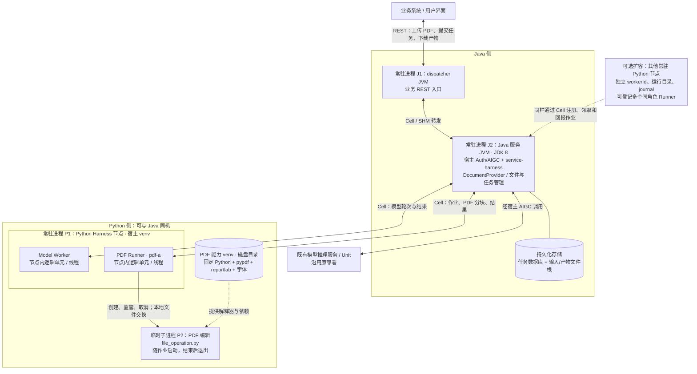

# 业务能力部署指南

本文统一说明数据查询、加工、单图分析、必需步骤检查与结构化报告的安装和人工运行顺序。基础服务与 dispatcher 配置见 [服务部署](README.md)，能力契约见 [业务数据](BUSINESS-DATA.md)和[执行检查与报告](WORKFLOW-REPORTS.md)，业务资源跨环境晋级见 [发布与回退](RELEASE-MANAGEMENT.md)。

## 持续互动与会话

1. 按[构建与安装](#构建与安装)部署匹配的 Java 组件和 Python Harness 节点。选择具备结构化输入能力的工作单元处理 `generation.structuredInput=true` 的任务。按[存储配置](STORE.md)让启动自检创建或升级消息、会话字段及索引。共享一个库的写入节点使用同一版本。
2. 在私有 `harness.properties` 中启用 `interaction.enabled=true`，重启后核对 capabilities 的 interaction 和各 worker 的就绪状态。部署可按[执行配置](config/harness-execution/README.md)配置执行、等待和总期限。自定义 CompletionGuard 按 `taskInput/supportsInteraction` 接收输入变更。协调器兜底扫描默认每批后等待 1000 ms。
3. 使用获准 Cube 用户发起带 `newConversation: true` 的 run。执行中补充要求并核对受理与采纳事件。出现问题时刷新并按当前等待身份回答，再验证改要求使旧问题失效和取消后的物理对账。终态后用同一 `conversationId` 创建后续任务并核对递增序号。部署多个同角色单元时，按[监控指标](RESILIENCE.md#运行边界)核对共享容量和派发等待。

业务客户端接入见[持续互动契约](INTERACTION.md)。本机对话客户端的启动命令见[客户端说明](../../harness/client/README.md)。

## 上下文预算与证据评测

将进程实际使用的 `execution.profiles` 指向配置目录下的 `harness-execution`，按[执行配置](config/harness-execution/README.md)合并任务状态、历史压缩、证据调整、模型预算和语义摘要选项。模型的 `nativeTools` 与 Java adapter 及 Python 节点能力须匹配。使用精确计数时安装匹配模型、模板和 tokenizer 的可信计数器。回读工具要求 `resource.read` 授权。

人工运行一个多轮任务，确认完整链接、引用、已采纳输入和缺失证据的处理。需要评估真实模型时，按[Trace 与评测](TRACE.md)冻结相同任务、模型和授权配置，收集 Trace 和独立复核。只读能力发现可按[业务数据能力](BUSINESS-DATA.md)部署，实际任务就绪状态可通过 `task-profiles` 查看。

## 可配置资源检索部署

此能力可独立部署，契约见 [任务结构化与业务资源检索](RETRIEVAL.md)。更新匹配的 `cube-service-harness-3.0.jar` 和 `cube-service-harness-skill-3.0.jar`，安装位置分别为原 `cellets/` 与宿主扩展 `libs/`；先 drain、保留在途账本，再成套替换。检索复用现有账本与普通 tool Runner，不新增 Python 协议或视觉 Unit 要求，一个 JVM 可接多个独立 Runner。持续互动和问答的配置见[持续互动与会话](#持续互动与会话)。

1. JDK 8 下执行 `ant -f service-harness/build.xml build` 和 `ant -f service-harness-skill/build.xml build packages`，生成核心/扩展 JAR 与 `service-harness-skill/build/packages/retrieval-v1.zip`。用两个模块的 stage 目标组装核心、扩展、检索契约和配置模板。
2. 私有目录安装 `service-harness-skill/config/retrieval.properties.example`，按已登记 source 的 secretRef 设置 `secret.<secretRef>`。broker.providers 追加 retrieval，登记 `broker.provider.retrieval.class=cube.service.harness.skill.RetrievalProvider` 和实际 `broker.provider.retrieval.config` 绝对路径。保留其他 Provider；配置 WorkflowGuard 类及其私有 workflow.properties，启用 `interaction.enabled=true`。部署权限上限、身份和租户 policy 均加入 `resource.retrieve` 及业务资源读取权限。
3. 发布可信 `common/retrieval` 工具 ZIP，取得 ready digest。登记业务查询及可选区域目录的 source，合并 admin.sources.allowedOrigins/allowedPaths/secretRefs，给实际对话用户 source-grant；每次请求的 HMAC 与业务用户 ACL 沿用已有契约。业务配置不授予访问权限。
4. 使用 [教程检索资源](../../tutorials/examples/retrieval-package/) 编写纯资源业务包：SKILL.md、retrieval-profiles.json、workflow-requirements.json，依赖锁只需 common/retrieval。`execution.version=resource-retrieval-v1`，按真实 digest 构包、签名发布、合并 policy 并 CAS 切换。工具、来源和业务配置共同预检；不需要巡检分析的 processing/analysis/report 文件。maxTools 要覆盖1次规划、各页和预计输入修订，仍受总期限与预算限制。
5. 启动 Java 及多个独立 tool Runner，核对 task-profiles 的业务技能与 common.retrieval.query 就绪。人工依次运行固定日期的录像、图片、已发布文档查询；确认时间/区域/类型；缺区域时选择真实选项；执行中补充“改成图片”；刷新待答页面后继续；测试授权撤销、完整空结果及游标分页。读取 `result.result.retrieval` 的完整覆盖与固定版本引用，再由业务系统重新鉴权取内容。

教程的独立可运行业务接口、构包与客户端命令见 [资料检索接入](../../tutorials/src/content/docs/reference/resource-retrieval.md)。回退时按[恢复与运维](RESILIENCE.md#部署升级与停止顺序)保留在途账本并恢复匹配的 JAR、配置、policy 和 binding。

## 部署组成

Java 构建、测试与运行使用 **JDK 8**。common、service、dispatcher、Harness 核心与技能扩展须配套；视觉桥接需要同 Kernel/JVM 的 Auth/AIGC 与 FileStorage。普通 Python model/Runner 使用独立 Python 3.11 环境。

一个 Harness JVM 支持多个 Python 服务单元，同一角色可有多个；每个单元独占 workerId、实例身份、runtimeDir、journal 和租约。调度按角色、能力、健康与实际容量选择，共享物理后端统一计容。跨机器配置见 [REMOTE-NODES.md](REMOTE-NODES.md)。

| 产物或配置 | 安装/生效方式 |
| --- | --- |
| `cube-service-harness-3.0.jar` | 宿主 cellets/，与技能扩展配套更新 |
| `cube-service-harness-skill-3.0.jar` | 宿主 libs/，提供 Provider 与 WorkflowGuard |
| Python `harness/runner_process.py`、`harness/runner_sdk.py` | 更新全部普通 Runner 节点并重启，根入口和 SDK 派生入口统一 UTF-8 |
| Python `harness/model_adapter.py`、`context_compaction.py`、`context_summary.py` 及 `contracts/` | 用完整 Python 节点 ZIP 更新全部模型单元；同步实际 wire 渲染、预算重建、可选摘要和五次 wireAttempt 契约 |
| `scripts/evaluate_traces.py`、`quality_evaluation.py`、`behavior_evaluation.py`、`replay_trace.py`、`prepare_adjustment_evaluation.py` | 同目录部署的离线评测、案例/配置准备及待复核 sidecar 工具；证据与基线比较见 [TRACE.md](TRACE.md)，不需新增在线服务 |
| data、processing、capability、capabilities、time 工具 ZIP | 管理员发布 executable 工具，授权其实际 ready release |
| Provider、guard、身份及视觉配置 | 合并到私有绝对路径与宿主配置，重启生效 |
| 签名业务资源 ZIP、policy、binding | 业务包锁定真实依赖，发布 policy 后 CAS 切换，新 run 生效 |
| 业务系统报告与来源页面 | 读取规范 report、校验来源关联，鉴权展示固定版本原图 |

## 构建与安装

在 `cube-server/` 执行；预先准备匹配的 common/service/dispatcher 及基础依赖：

```powershell
ant -f service-harness/build.xml build
ant -f service-harness-skill/build.xml build packages
ant -f service-harness/build.xml stage "-Dstage.dir=C:/releases/harness-business"
ant -f service-harness-skill/build.xml stage "-Dstage.dir=C:/releases/harness-business"
```

两个 stage 目标合并核心和技能扩展。需要含 common、dispatcher、Python 节点、本机对话客户端和离线评测脚本的完整分发包时，从 `cube-server/` 运行 `python -B service-harness/scripts/build_interaction_delivery.py --python-root ../../apexnova-wisdom --output <新发布目录>`。构建前准备匹配的四个 JAR。`checksums.json` 用于逐文件校验。升级前关闭新准入、drain 并对账未决任务，保留原 JAR、配置、release/policy/binding；同时安装两个 JAR，移除重复旧副本，合并配置后重启。模板不覆盖私有值。在途任务固定旧 schema 或旧能力时须先收尾，再升级 Provider 与工具。

## Provider 与交付检查

将 [data.properties.example](../service-harness-skill/config/data.properties.example)、[capability.properties.example](../service-harness-skill/config/capability.properties.example)、[processing.properties.template](../service-harness-skill/config/processing.properties.template)、[time.properties.template](../service-harness-skill/config/time.properties.template) 复制到私有目录。按实际需要把以下登记项合并到宿主配置，保留原有 Provider 与权限：

```properties
broker.providers=data,processing,capability,time
broker.provider.data.class=cube.service.harness.skill.DataQueryProvider
broker.provider.data.config=C:/private/harness/data.properties
broker.provider.processing.class=cube.service.harness.skill.DataProcessProvider
broker.provider.processing.config=C:/private/harness/processing.properties
broker.provider.capability.class=cube.service.harness.skill.CapabilityInvokeProvider
broker.provider.capability.config=C:/private/harness/capability.properties
broker.provider.time.class=cube.service.harness.skill.TimeProvider
broker.provider.time.config=C:/private/harness/time.properties
execution.permissions=skill.list,skill.activate,resource.list,resource.read,resource.search,data.query,data.process,capability.invoke,time.read,artifact.write_text
broker.completion.guard.class=cube.service.harness.skill.WorkflowGuard
broker.completion.guard.config=C:/private/harness/workflow.properties
```

将 [workflow.properties.template](../service-harness-skill/config/workflow.properties.template) 安装到对应绝对路径，内容为 `workflow.max.repairs=2`；Linux 使用实际绝对路径。guard 是 final 检查扩展，不加入 broker.providers。两个 JAR 不匹配或类/文件配置错误时启动拒绝。

工具执行、files/grant、普通 Runner 与可信可执行包配置按 [TOOLS.md](TOOLS.md) 启用。部署权限上限、可信身份和租户 policy 均须允许相应操作。上传业务资源包不会安装 Java 类或 executable 工具，也不会提升权限。

## 发布身份、数据源与视觉路由

远程资源包必须签名，且不能包含 executable 工具。以下为需替换的管理身份示例，四类白名单独立于业务 policy，默认不开放：

```properties
admin.release.subjects=forest-domain/10010
admin.policy.subjects=forest-domain/10010
admin.source.subjects=forest-domain/10011
admin.source-grant.subjects=forest-domain/10011
admin.tenant.forest-domain.signers=f-author
runtime.signer.f-author=<Base64 X.509 DER RSA public key>
admin.sources.allowedOrigins=https://forest.example.internal
admin.sources.allowedPaths=/api/patrol/records,/api/media/content
admin.sources.secretRefs=forest-source
```

HTTP 模式分别登记不可变 source 与对话用户 source-grant，在 data/capability 私有配置中设置与业务系统验签器一致的 secret；详见 [接口约定](../../forest/ForestHanressEngineeringAPIRef.md)。仅上传模式无需 HTTP source，但须绑定 JSON 与全部图片 Input。附件查询和视觉读取随技能扩展 JAR 部署。按下方人工运行顺序，使用一份 JSON 快照和一张已绑定图片验证查询、加工和分析。

真实视觉 Unit 上线并预热、隔离算力后，在 AIGC 私有 aigc.properties 中设置 `harness.media.dedicated=true` 与实际 `harness.media.units`，capability 的允许路由须一致。只声明已就绪的 connector 和分析 profile；任务创建会预检包内全部声明，调用时仍重查授权与容量。

人员、车辆等检测使用 `SpecializedDetection`、`adapter=specialized-detection`、`option.profile=thing`，并声明实际支持的 classes（例如 person、car、truck、bus、motorcycle、bicycle、train）。describe 使用 OmniMultimodal，烟火使用 SpecializedDetection/fire-smoke；同名业务 profile 不代表同一底层能力。部署前确认 thing 的权重、类别、容量和状态已经就绪，不能只修改业务别名。结构化检测读取真实 resultPayload.refs[].boxes；空 answer 不能解释为无目标，检测数量也不直接表示唯一人数或业务异常。

## 发布业务包与页面

1. 发布匹配 Provider/schema 的 data、processing、capability、time 工具 ZIP，确认实际 ready digest；同名同摘要且已获准的 release 可复用。工具源码与构建见 [技能工具包](../service-harness-skill/README.md)。
2. 将四个获准 digest 提供给业务包作者。包内包含 SKILL、规则、连接器、加工、分析、工作流与报告资源。只上传时同步移除 HTTP 连接器、对应加工 profile 与 workflow 路线；教程 HTTP/snapshot 同名技能一次只选一种。
3. 在 `forest/` 构建新版本，版本与输出文件名按实际发布指定：

```powershell
python -B scripts/build_package.py --dependency common/data=<获准digest> --dependency common/capability=<获准digest> --dependency common/time=<获准digest> --dependency common/processing=<获准digest> --version <新版本> --output build/fhe-patrol-candidate.zip
```

4. 经 admin/packages/validate、RSA 签名发布、policy 发布与 CAS binding 切换。policy.skillReleases 包含业务包及四个依赖，合并权限和配额；同名技能只固定一个 release。任何包内文件变更都会改变摘要，须重新构包、签名，不修改已发布 ZIP。
5. 业务系统使用 [render-report.js](../../tutorials/examples/render-report.js) 展示 result.result.report，按 citation 的 artifactId/hash 获取可信来源并鉴权取图。未声明报告要求的包保留原文本展示。

## 人工运行顺序

长视觉调用需一起更新 `cube-service-harness-3.0.jar`、`cube-service-harness-skill-3.0.jar`、AIGC 宿主的 `cube-service-3.0.jar`，以及 Python `harness/model_adapter.py`、`runner_worker.py`、`runner_process.py`、`runner_sdk.py` 和 `harness/contracts/`。宿主负责落库物理派发标识；只升级 Provider 无法补齐这段证据。JVM 继续使用 JDK 8。

在普通 tool Runner 的 `runner` 配置中显式设置 `"providerAwait": true`，它才会协商 `provider-await-v1`。然后可将 capability 私有配置设为 `capability.timeout.millis=60000`、`capability.queue.timeout.millis=20000`。默认仍为 20000/0；执行范围为 100..240000，槽等待为 0..40000 毫秒。Runner 等待上限为 `max(30000, 执行+排队+5000)`，最多 290000，并受任务剩余期限约束；准备、排队、派发和收尾共享签名 wire 期限，Provider 预留 1 秒交付时间。sandbox 保持 30 秒上限且拒绝此开关。旧 Runner 不领取超 30 秒作业；不能靠延长 Provider 单独升级。

报告判断按[证据策略](WORKFLOW-REPORTS.md)配置。更新规则时重新签名业务 release 并切换 policy binding。启用 `generation.toolNameStyle=readable-v1` 时，参与派发的模型单元须支持该格式。回退与在途作业保留见[恢复与运维](RESILIENCE.md)。

固定流程由业务包的 `workflow-requirements.json` 显式启用，旧包继续使用原模型循环。例如：

```json
{"execution":{"version":"fixed-patrol-v1","maxPages":64,"bindings":[
  {"profileId":"objects","attribute":"object-presence","dimension":"presence","content":"检测可见人车，仅返回观察"},
  {"profileId":"describe","attribute":"scene-description","dimension":"visible-scene","content":"描述可见场景，不推断授权或身份"}
]}}
```

此段合并到原工作流配置，保留 pipelines。绑定必须覆盖全部必需分析；属性、Unit、profile 和量纲交叉校验。宿主只向规划模型提供已授权查询及固定连接器 schema，范围与上传 ID 仍由用户输入确定。确认第一页后按完整 cursor 链、加工、逐记录分析、报告校验推进，每步计入原 32 次工具预算；同样执行权限、来源授权、审批、取消和期限校验。固定流程不增加模型轮数或令牌预算，不能把唯一人数、身份、业务授权或跨帧跟踪绑定到普通检测能力。

报告逐字复制确认的 answer/payload，并附 `semanticReview`。存在性、单图框数、唯一计数和业务判断分别表示；未知唯一数为 null。重叠框、小目标、烟雾/云雾、通行区解释及身份/行为推断进入有界复核提示，原始观察不改写。当前复核为确定程序检查，新增模型调用为 0，`semanticallyVerified=false`；需要人工核实的发现不能据此宣称已完成事实认证。

1. 启动业务系统两个只读接口，或上传并 complete JSON 与图片；启动智能体系统、多个已授权 model/Runner 与视觉 Unit。
2. 检查 service 健康与就绪，再以实际对话用户查询 dispatcher `GET /harness/v1/task-profiles`，确认模型、trusted-cpu、技能与能力可用，随后开启接单。
3. 用唯一 Idempotency-Key 向 dispatcher `POST /harness/v1/runs` 提交小范围任务，显式 skills 选择业务技能与四个依赖，先使用一两页资料。上传模式在 attachmentIds 中绑定两类 Input，instruction 指明快照 inputId。
4. 轮询 runs/events 至终态，查看 workflow.repair 与真实缺项。只有 succeeded 且 executionSettlement=confirmed 才作为成功答案；失败、取消、unknown 保留原事件。
5. 检查 workflow.satisfied、report 的记录统计、逐记录观测、判断、时间信任标记与原图；空资料应有真实空 dataset 报告。保存版本、digest、policy target、runId 与现象，作为后续实际环境质量、性能与故障验证依据。

一般巡检作者包与评估入口见 [patrol](../../patrol/README.md)。核心 JAR 更新后提供授权资源目录与结构化上下文压缩，须与上述 Python Runner 更新一并部署。先跑单页中文记录，确认完整 pageRef/datasetRef/mediaRef，再检查分页、空资料和失败恢复；不通过扩大 8 轮、32 工具、2 次修复或 5 分钟预算掩盖问题。多 worker 仍使用各自身份、目录、journal 与租约，升级按节点逐个 drain、对账、重启。

## 通用文件工具部署

PDF、图片、表格、报告和识别按需独立开通。启用 PDF、图片、表格或报告时，更新核心、技能 JAR 和 Python 节点包，合并 Provider 私有模板，将对应环境加入 `runner.fileEnvironments` 并逐 worker 授权其清单摘要。PDF 工具复用水印环境；其余需各自安装 `image-utility-v1`、`table-utility-v1` 或 `report-utility-v1`。报告和 PDF 水印共享能力目录中的校验字体，保留两者在节点包内的同级目录关系。

OCR 和转写走同 JVM 的 AIGC 宿主与 FileStorage，使用具备 `providerAwait=true` 的普通 tool Runner。更新 `cube-service-3.0.jar`，按需将 `OmniPerception`、`Speech` 加入 `harness.media.units`，设置 `harness.media.dedicated=true`，确认独立算力及 Unit 已预热。转写需要随 Python AI Unit 发布更新的 `cube/aigc_service.py` 与 `cube/unit_speech.py`，且 Speech 注册声明 `harness-bounded-transcription-v1`；现有 Speech 模型、FFmpeg 及 Unit 运行依赖继续由原部署管理。

先构建和签名发布所选 `common/pdf`、`common/image`、`common/table`、`common/report`、`common/ocr`、`common/transcription`。授权对应的 `pdf.process`、`image.process`、`table.process`、`report.process`、`ocr.recognize`、`transcription.recognize`，并在任务配置选择相应执行器。依次检查 worker 环境匹配、上传与绑定、小文件结果、产物鉴权下载。识别工具再用已知文字图片和短音频核对 Unit 回执、结果及已知错误；撤销已发布版本时按原有 drain、对账和版本切换流程操作。

## PDF 文字水印部署

此能力可独立安装，不依赖业务数据源、视觉 Unit 或业务 WorkflowGuard。能力契约与限制见 [文件处理](FILE-PROCESSING.md)。文件编辑在 Python 工作器执行，Java 负责授权、调度及文件账本。

### 部署结构与进程关系

先以一个 Java Harness 服务 JVM、一个 Python Harness 节点进程部署，沿用已有 dispatcher、Auth/AIGC 与模型后端。下图的 Java 侧和 Python 侧可以同机，也可以分布在不同机器；一个 Java JVM 可以接入多个 Python 节点。

正式业务部署将 Harness 挂入已有 Cube 服务 JVM，保留宿主 ServiceCarpet，通过同 Kernel 的 Auth/AIGC 模块取得用户认证与推理能力；合并模板为 `config/cohost-cellet.xml`。



图中 J1、J2、P1、P2 是示意进程标识，不是固定 PID。Model Worker 处理模型轮次，PDF Runner 领取并监管文件作业；两者可作为线程运行在同一个 P1 进程内。Model Worker 通过 Java 推理网关使用现有模型服务，PDF 子进程仅负责文件编辑。已有独立 worker 进程也可继续使用，`runner-document.template.json` 就是独立 Runner 的配置格式；节点合并方式见 Python 运行包的 `harness/NODE.md`。

venv 是磁盘上的解释器与依赖目录，不需要单独启动服务。P1 使用宿主 venv；P2 使用 PDF venv 的解释器，避免向宿主加载 PDF 库。启动和执行前还会短暂创建环境校验子进程，图中省略。一个 Runner 可以配置多个能力 venv，每次按作业的环境身份和摘要选择；目前交付的固定文件处理器是 PDF 水印。

| 部署位置 | 放置内容 | 需要启动的进程 |
| --- | --- | --- |
| Java 服务目录 | 核心 JAR 放 cellets/；技能 JAR 放 libs/；DocumentProvider 配置、document-python.json、同一份 environment.json、获准的 document 技能 ZIP | 原 Java 服务 JVM，重启加载更新；Provider、runtime JSON 和 SKILL ZIP 都不是独立服务 |
| Python 运行目录 | 完整节点包、宿主 venv、节点配置；每个逻辑 worker 的独立运行目录与 journal | 一个 Harness 节点进程；也可沿用各 worker 独立进程的部署方式 |
| Python 能力目录 | PDF 独立 venv、environment.json、requirements.lock、字体与许可 | 无常驻进程；Runner 按作业启动 PDF 子进程 |
| 现有平台 | dispatcher、模型服务及持久化存储；Auth/AIGC 保留在 Java 宿主 JVM | 沿用既有进程和部署方式 |

一次请求的顺序是：业务系统上传 PDF → Java 保存 Input 并创建任务 → Model Worker 结合模型生成工具参数 → Java 选择环境匹配的 PDF Runner → Runner 下载分块并启动 P2 编辑 → 上传新 PDF 到 Java 产物库 → 业务系统鉴权下载。Python 主机不需要挂载 Java 的文件根，文件通过现有通道传输。

### 安装与启动顺序

1. 以实际 JDK 8 构建并更新 `cube-service-harness-3.0.jar`（service 的 cellets/）与 `cube-service-harness-skill-3.0.jar`（service 的 libs/）；更新全部相关 Python 单元的完整运行包，保留各自 workerId、runtimeDir 和 journal。dispatcher 无新增业务路径，继续使用配套版本。
2. 在 Python 主机准备清单要求的 CPython 3.11.9。节点宿主保留自己的 venv 和 `harness/requirements.txt`。从 Python 发行包根执行下列安装命令，创建独立 PDF venv；不要向宿主或其他能力 venv 安装这些库。

   ```powershell
   python -B harness/scripts/install_file_environment.py --manifest C:/private/harness-node/harness/environments/pdf-watermark-v1/environment.json --destination C:/private/venvs/pdf-watermark-v1
   ```

   安装脚本先核对清单、锁和资源，要求目标目录不存在，使用全部依赖的 wheel hash lock 并运行 pip check；pip 忽略用户配置与 PIP 环境变量，启动和任务执行不运行 pip。离线部署提前准备锁定的目标平台 wheel，安装命令追加 `--wheelhouse C:/private/wheels/pdf-watermark-v1`。完整环境含固定字体、OFL 许可和来源信息。Linux 使用相同命令，配置中的解释器改为 `/private/venvs/pdf-watermark-v1/bin/python`。
3. 将同一份环境清单安装到 Java 主机，复制 `service-harness-skill/config/document.properties.template` 为私有配置，设置 `environment.manifest` 绝对路径。在现有 `broker.providers` 中追加 document，配置 `broker.provider.document.class=cube.service.harness.skill.DocumentProvider` 及对应 `.config` 路径。Java 不需要 PDF Python 库。
4. 按 `runner-document.template.json` 配置 PDF 工作器，设置 `providerAwait=true`，在 `fileEnvironments` 中填写独立解释器、清单的绝对路径。每个工作器独立身份、目录和 journal。单 JVM 可接多个同角色 PDF 工作器；同一节点也可同时配置其他能力的独立环境。`harness java-config --config <节点配置>` 输出逐 worker 的 role、capacity 和 `file.environment.<id>=<digest>` 授权；单 worker 部署可按安装输出的 descriptor 填写。
5. Java 启用 `files.enabled=true` 并准备专用文件根及原有文件密钥；执行权限和租户 policy 均授予 `document.watermark`。安装 `config/harness-execution/document-python.json` 执行器，32 MiB 工作区容纳输入、输出与中间资料。发布 `document-v1.zip` 为 ready，将实际 release 摘要并入租户 policy。保留现有权限和技能，勿用模板覆盖已有策略。任务可指定 `runtime: "document-python"`；模型需有工具调用能力，预算建议至少 180000 毫秒。
6. 先执行 doctor，再按原节点脚本启动；从任务目录确认文档技能、匹配执行器和工作器可用。上传一个不超过 10 MiB 的 PDF，complete 后将 inputId 列入 attachmentIds，提交“给这份 PDF 加上‘内部资料’水印”。检查任务成功、唯一 PDF 产物、实际下载及摘要，再检查指定页码、中文、旋转页和缺参问答。原文件应保持不变。

普通 Runner 不具备环境声明时不会领取 PDF 作业。环境缺失、Python 补丁版本不符、依赖集合或内容变化、字体变化、Java 授权摘要不符时明确拒绝；不要通过扩大权限、改用全局 Python 或在运行中的 venv 安装库绕过检查。新增库版本须创建新环境档案并验证，随后 drain 工作器并成套切换 Java/Python 配置，保留在途任务所用旧环境。

## 本地验证入口

在 `cube-server/` 使用实际 JDK 8：

```powershell
ant -f service-harness-skill/build.xml test
ant -f service-harness/build.xml test-runtime test-inference test-execution test-tools test-control-files
ant -f service-harness/build.xml test-transport
python -B -m unittest discover -s service-harness/scripts/tests -v
```

回归覆盖真实签名包、SQLite/Broker、分页/来源、加工、执行检查、报告引用及恢复预算；视觉调用使用明确夹具。真实识别质量、耗时和部署容量在人工部署后验证，现场验收不作为先行安装与运行的前置条件。
