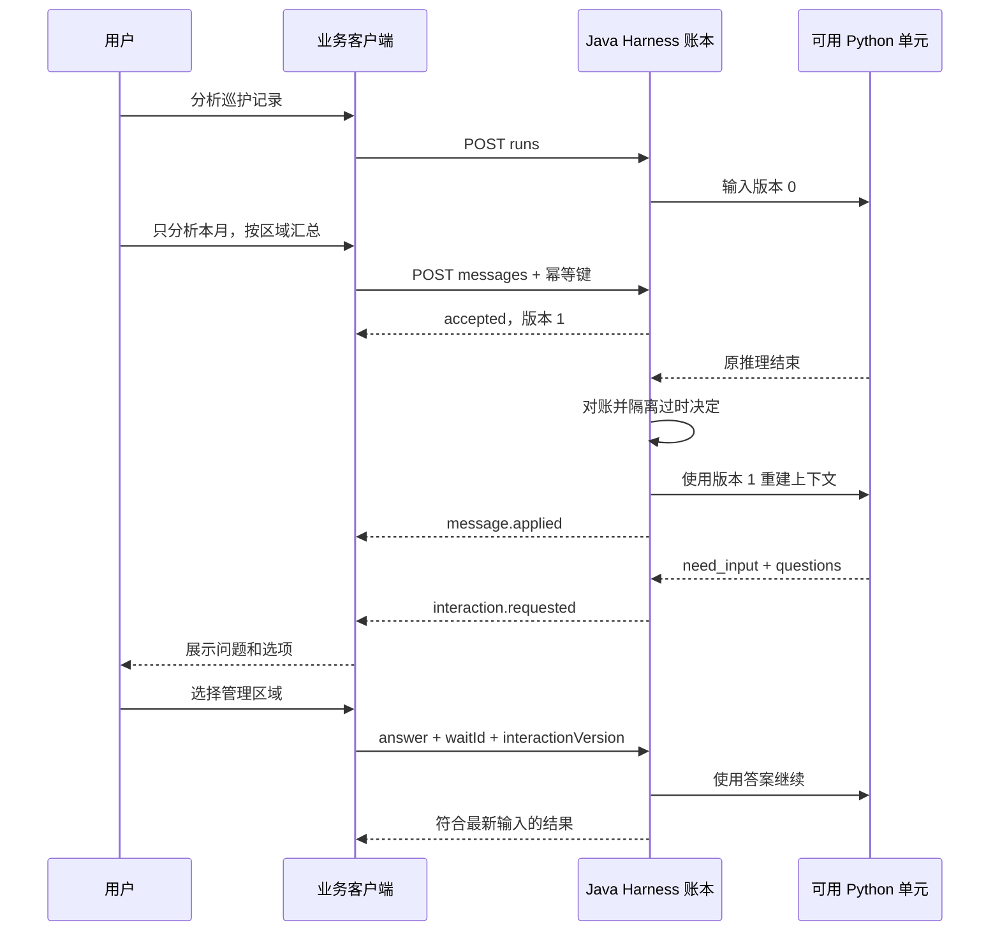

# Harness 持续输入与主动问答

Harness 提供执行中补充要求、改变任务方向、系统主动提问并等待选择、回答后继续，以及终态后的关联任务续接。Java 账本保存消息、问题、输入版本和回执；Python 单元处理不可变的模型/工具作业。完整接入客户端见 [任务对话客户端](../../harness/client/README.md)，配置与部署顺序见 [部署指南](BUSINESS-DEPLOYMENT.md)。

## 用户行为与执行语义

| 操作或时机 | 行为 |
| --- | --- |
| 首条输入 | 创建异步 run，初始输入版本为 0 |
| queued 或运行中补充 | 事务受理消息，分配递增 messageSeq/inputRevision；下一轮使用全部新要求 |
| 模型正在生成 | 新消息立即入库，旧推理完成后结算；过时 final、问题和未创建意图的工具提案不生效 |
| 工具尚未准入 | 逐个检查输入版本，过时提案停止派发，重新规划 |
| 工具已经准入 | 保留 job 身份、worker/实例与物理容量占用，等待真实完成或 unknown 对账；新要求不能撤销已有副作用 |
| 等待输入 | 回答绑定当前 wait；普通 instruction 使问题失效，重新规划 |
| 等待审批 | 普通补充使旧提案失效；补充或问答不构成审批，后续动作仍须独立审批 |
| 消息与 final 并发 | 对同一 run 加锁串行提交：消息先提交则旧 final 被拒绝；final 先提交则消息返回 RUN_TERMINAL |
| cancelling 或终态 | 拒绝新的执行输入；相同幂等键仍回放已受理回执 |
| 完成后继续 | 使用 conversationId 创建会话中的下一 run，或通过 parentRunId 继承旧式父链历史 |

自然语言冲突由最新明确更正指导模型；平台权限、技能允许名单、固定业务要求和预算不由用户补充扩大。模型/运行时/技能选择在创建时固定，需要修改配置时创建新 run。当前问答为阻塞等待，不包含询问期间继续执行独立分支的调度。



## 消息契约

所有业务请求使用 dispatcher 的 `/harness/v1`、Cube Bearer；POST 使用 Idempotency-Key。同一键同一正文回放原回执，同一键改变正文返回 IDEMPOTENCY_CONFLICT。路由复用 common/HarnessAction，dispatcher 无需独立聊天状态。

```http
POST /harness/v1/runs/{runId}/messages
Content-Type: application/json
Idempotency-Key: <本次操作唯一键>
```

```json
{"kind":"instruction","input":{"instruction":"只分析本月，按区域汇总","attachmentIds":[]}}
```

202 返回 messageId、messageSeq、inputRevision、kind、input、receivedAt 和 status=accepted。GET `/runs/{runId}/messages?after=0&limit=100` 返回 messages、nextCursor、inputRevision 和 appliedInputRevision；after 是消息序号，limit 为 1..100 的条数上限。消息页按约 512 KiB 限制聚合大小，至少返回一条；少于 limit 不代表读完，应以 nextCursor 继续，直到追上 inputRevision。初始输入仍在 run.created，消息列表包含后续补充和旧 resume 转换的回答。

列表 status 为 accepted、applied 或 unprocessed_terminal。applied 代表输入已绑定到后续模型上下文或可信宿主规划，不代表要求对应的业务动作已完成。任务在纳入消息前取消、失败或到期时显示 unprocessed_terminal；原受理回执保持不变。列表 request 保存原始消息/回答，input 是用于模型的输入，结构化回答会附上可信题干与所选标签。

默认每个任务最多 128 条补充/回答、32 条尚未采纳消息，超限返回 HTTP 429 MESSAGE_QUEUE_FULL。指令最长 32768 字符，附件最多 16 个，均须通过归属、ready 与有效期校验；HTTP 请求继续受平台的总大小及嵌套限制。消息不重置任务配额和预算。

## 主动问题与回答

need_input 保留必需的 question 字符串；可选 questions 数组支持 1..3 题，每题最多 8 个选项。服务端还检查题目/选项 ID 唯一，并要求至少存在选项或允许自由回答。

```json
{"kind":"need_input","question":"请选择统计口径","questions":[{"questionId":"basis","prompt":"按哪种区域汇总？","options":[{"id":"management","label":"管理区域"},{"id":"administrative","label":"行政区域"}],"allowFreeText":true}]}
```

read-run 的 interaction 返回服务端 waitId、interactionVersion、expiresAt、kind 与 details。回答提交：

```json
{"kind":"answer","waitId":"<当前 waitId>","interactionVersion":12,"input":{"instruction":"按以下回答继续","attachmentIds":[]},"answers":[{"questionId":"basis","optionId":"management"}]}
```

每题必须回答；text 为可选自由文本，只有 allowFreeText=true 才允许。服务端校验题号、选项、等待版本、归属和期限，回答与问题消费、输入版本推进和运行恢复原子提交。单个允许自由回答的问题可省略 answers，使用 input.instruction。非结构化问题直接使用 input。重复操作用原键回放；换键再次消费同一 wait 返回 WAIT_STATE_CONFLICT，错误版本返回 INTERACTION_VERSION_CONFLICT，已到期返回 WAIT_EXPIRED。

显式新要求用 kind=instruction，使 pending 问题或审批标记 superseded。等待已过期时，instruction 与 answer 均拒绝，不能借调整要求延长等待。旧页面的 answer 不会被误绑到后来出现的问题。原 `/resume` 保持原格式与 expectedVersion，内部保存同一消息事实，共享总消息数和待采纳消息上限，并遵守结构化问题的自由回答限制；不能用自由文本绕过必选题或多题回答。resume 历史只注入一次上下文。升级前没有 interactionVersion 的等待按版本 0 恢复。

合法 need_input 直接从已确认轮次进入等待，无需提前组装下一轮模型上下文；题号或选项重复、无可用回答方式等语义错误会以明确错误码结束任务，避免一直停留在运行中。

模型配置 generation.structuredInput=true 时，原生 request_user_input 声明 questions，JSON 模式也展示相同结构。Python v3 模型 descriptor 声明 structuredInput=true；Java 按能力选择 worker，未声明的旧 worker 不接此类模型作业。未开启该标志时保留原 question 提示格式。Java/ Python 的严格契约和渲染保持同步。

## 持久化与执行边界

harness_run 保存 input_revision、applied_input_revision 和等待时间累计；harness_message 保存有序正文、原请求、时间和身份归属关系。round/tool intent 保存 input_revision，tool 另有 admitted_at。输入受理、模型轮次创建、派发准入、问题创建和最终提交均以同一 run 行为互斥边界。模型推理中的消息不会原地修改已有 requestJson。

ContextEngine、TaskState/Progress/Summary、Java ModelWire 与 Python adapter 都识别新增用户输入。过时决定保留在事实账本，但不再作为可执行决定注入历史；已真实创建的调用与结果继续严格配对。用户输入不被当成技能资料，工具和技能资料不能伪装为用户指令。输入变化使旧语义摘要绑定失效。

CompletionGuard.Resources.taskInput 提供统一输入版本、输入集合及带持久接收时间的原始消息，默认 supportsInteraction=false 兼容旧扩展加载。配套 WorkflowGuard 声明支持；按最新版本过滤用于业务完成检查的执行证据，使 fixed-patrol-v1 重新请求查询范围，再推进固定步骤。旧证据仍留在账本。固定流程不解释任意新增业务能力，不放松原检查；不支持互动的旧 guard 明确拒绝目标调整。

`resource-retrieval-v1` 使用同一输入版本边界，由可信宿主从原始消息和接收时间规划时间、区域及资源类型，直接创建当前问题并推进获准检索。新输入使旧计划和旧页证据失效，宿主采纳会推进 applied 水位；具体契约见 [资源检索](RETRIEVAL.md)。

固定流程校验、修复预算记录和基于输入的成功或失败收尾均绑定对应输入版本，提交事务拒绝过时结果。取消已受理后，迟到的成功或输入校验失败不能覆盖 cancelling 状态；取消和执行对账继续遵循原结算规则。

消息与问题不依赖特定 Python 进程的会话内存。一个 JVM 可接多个同角色 model/runner 单元，新轮次按能力、健康和可用容量选择任意单元；原在途作业继续绑定原 worker、instance 和 journal。逻辑取消不提前释放共享物理后端容量，unknown 不通过换单元重跑。

## 客户端、事件与重连

事件包括 message.accepted、message.applied、interaction.requested、interaction.answered、interaction.superseded，以及原 run.waiting_* / control.resume 等。按 eventSeq 续读，按 messageId/waitId 去重。有限 SSE 页和普通事件页均可使用，页内聚合大小约 512 KiB，至少返回一条；少于 limit 仍需继续追赶 read-run 的 eventSeq。配套客户端使用轮询事件页，并从 read-run 与消息列表对账；终态后的事件或消息读取断网也会继续重试，直至结果展示完成。

客户端在运行和等待时保持输入框可用，显示问题卡片、页面标题提醒和截止时间。页面刷新恢复聊天 ID、runId、游标与未确认的请求；身份过期后更新原身份令牌续读。请求结果不确定时保留原 key/body 供重试，避免重复创建或追加。客户端本地保留当前聊天正文，不保存令牌。审批保持独立；离线系统通知、逐 token 流、会话列表和上传界面不在此客户端内。

## 持久会话

使用 `POST /harness/v1/runs` 创建首个任务时设置 `newConversation: true`。受理快照和后续读取返回 `conversationId` 与从 1 开始的 `conversationSequence`。最新任务进入终态后，用同一 `conversationId` 创建下一任务；终态但执行结算仍为 unknown 时也可续接。历史对该任务只提示执行未确认。活跃任务中的新要求使用消息接口。

可在新建或续接时传 `conversationInstructions` 保存长期要求，最多 4096 字符。省略时沿用，空字符串清除。会话仅对同租户同主体可见，并在创建事务内串行分配序号，同键同请求重放原回执。`newConversation`、`conversationId` 和 `parentRunId` 互斥。

每个新 run 固定使用最近最多 32 个 run、64 条消息、24 KiB 的历史及当前长期要求。裁剪会在上下文中明示，原文和证据仍可按原 run 读取。历史中的附件 ID 不进入新上下文。续接需要的附件应在本次 `input.attachmentIds` 明确传入，由本次授权校验。业务固定流程按当前 run 的输入和证据完成检查。

## 通过父 run 接续

create-run 可选 parentRunId。父任务须属同一租户与主体、已终态且 executionSettlement=confirmed；活动父任务返回 PARENT_RUN_ACTIVE，未确认执行返回 PARENT_RUN_UNSETTLED。创建事务在幂等回放之后检查条件，将历史快照保存为 conversation.history，并按当前策略重新选择和授权新任务。

继承父链用户原文及终态答复，不继承工具执行权限、批准或可用执行证据。所有历史 input 附件重新校验并绑定；失效附件明确拒绝。最多继承 16 层、128 条历史消息、64 个附件、49152 个 UTF-8 字节，超限返回 CONVERSATION_LIMIT，不静默裁掉要求。模型上下文另受原预算限制，超出时同样明确拒绝；用户可新开对话。

## 时间与兼容性

累计执行预算 maxActiveMillis 扣除持久化的输入/审批等待；每次等待同时受 maxInteractionWaitMillis、control.wait.millis 和任务总期限约束。maxLifetimeMillis 包括等待并取租户业务上限，追加或重启均不续期。等待任务仍占活跃任务配额。配置细节集中见 [执行配置](config/harness-execution/README.md)。

interaction.enabled 默认 false，关闭后不再受理新的 messages；已接收消息、在途作业、问题和旧 resume 仍可对账/恢复，结构化旧问题需用符合规则的旧恢复方式或重新开启消息入口。新旧 worker 混用时由 structuredInput 能力与模型配置限制派发。升级会添加消息、输入版本及等待字段；启动迁移支持已知旧版本，保留原任务和原始 SQL 升级链。降级须使用升级前备份并先收尾，不将新账本直接交给旧服务。

## 回归入口

Java 使用实际 JDK 8：`ant test-interaction test-execution test-runtime test-control-files test-tools test-inference`。interaction 测试允许 `-Dinteraction.test.config=<可丢弃数据库配置>`，支持与既有执行测试相同的 SQLite/MySQL 配置入口。测试覆盖连续输入、同键重放、跨用户拒绝、延迟旧模型、跨 worker 续接、过时工具、结构化回答、重启、终态竞争、派发边界、持久等待预算与父子任务历史。

配套 Python 执行 `python -B -m unittest discover -s harness/tests -v`，客户端验证入口见其 README。真实业务模型质量、目标 MySQL 部署及现场时延在相应环境运行后核对；不作为继续交付实现的前置条件。
