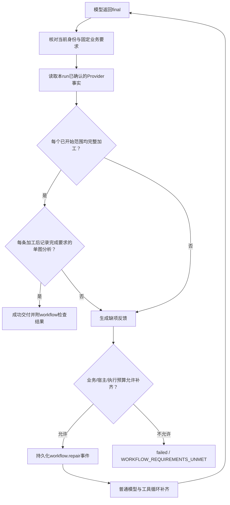

# M3 必需步骤门禁与人工部署

M3 在服务端交付 final 前，核对业务包声明的查询、加工、单图分析是否有真实完成证据。模型漏步骤时收到缺项反馈，使用普通工具循环有限补齐；持续跳步则任务失败，不交付成功答案。M1/M2 的接口、数据加工及来源展示继续使用。

**本阶段可以先行部署。** 本机增量 staging 为 `service-harness-skill/build/stage-m3/`：`cellets/` 是新核心 JAR，`libs/` 是新技能 JAR，`harness-skill/config/` 是配置模板，`harness-skill/packages/` 是九套工具 ZIP。它须合入已有、匹配的 Harness 部署；不要用模板覆盖现场私有配置。本次同时更新两个 JAR，不能只换技能扩展。

F 正式包为 `forest/build/fhe-patrol-v3.zip`；首次人工跑通推荐 `forest/build/patrol-tutorial-http-v3.zip`，无回访条件时选 `patrol-tutorial-snapshot-v3.zip`。同名教程技能一次只授权一种模式。包锁定本机工具 ZIP 的真实 manifest digest；线上用 BZ 实际获准摘要重新构包、校验和签名。本地构包不自动发布。

## 1. 配置和生效范围

业务包增加可选资源 `workflow-requirements.json`，由 manifest 声明 `role=resource`，参与包摘要、签名和 run 固定快照。示例：

```json
{
  "version": "1",
  "maxRepairs": 2,
  "pipelines": [{
    "id": "patrol-http",
    "connectorId": "patrol-records",
    "processingProfileId": "patrol-summary",
    "analysisProfileIds": ["describe"]
  }]
}
```

| 字段 | 约束和意义 |
| --- | --- |
| version | 固定字符串 `1` |
| maxRepairs | 整数 0～2，允许几次缺项补齐；0 表示首次缺项即失败 |
| pipelines | 1～8 条获准路线；id、connectorId 各自唯一；每个已声明 connector 必须有且只有一条路线 |
| processingProfileId | data-processing.json 中存在的 profile，且其 connectorId 与该路线一致 |
| analysisProfileIds | analysis-profiles.json 中的唯一 profile ID，最多8个；每条加工后记录须完成列表中的每个 profile；空列表表示只要求查询和加工 |

字段集严格校验，不接受自由脚本或未知字段。HTTP 与上传路线是可选入口，不要求两者同时执行；一旦开始多个查询范围，每个范围均须满足要求。

门禁检查本 run **已经激活**的业务 release。F 创建 run 时应显式提交 `skills`，包含业务技能名及所需工具；显式选择会固定并激活对应 release 和依赖。仅作为候选、未激活的技能不强制执行。无此文件的老包保持原有 final 行为；新包在新版宿主未配置 guard 时，校验、准入与交付会报 `WORKFLOW_GUARD_UNAVAILABLE`，不会静默放行。旧版核心不具备此检查，必须先升级两个 JAR 再发布 M3 包。

## 2. 服务端怎样核对



证据来自现有 ProviderStore 事实与工具作业/调用账本联查：作业必须 actual_finished=1、effect_status=completed，原工具调用必须 confirmed 且标准结果 status=success。只使用当前租户、用户和 run 的事实，并按固定业务技能隔离。模型自述、同名 media-source.json、自行构造的引用、执行意图、错误或 unknown 均不能满足要求。

| 步骤 | 必须成立的证据 |
| --- | --- |
| 查询 | common.data.query.v1 的 data-page；按 connectorId + queryHash + snapshotId 分组，缺起始页/续页、页内容冲突不能通过 |
| 加工 | common.processing.process.v1 的 data-set；profileHash 匹配固定配置、coverage.queryComplete=true、pageRefs 绑定真实已确认页，并覆盖该范围所有已观察页位置 |
| 分析 | common.capability.invoke.v1 的 analysis；mediaRef 来自加工记录 sources，profileId 与 profileHash 都匹配固定配置 |

新查询事实另记内部稳定页位置，重复查询导致的新能力引用不会被误判为新的业务页。等价的多个完整 dataset 中，只要其中一个覆盖所有观察页并有齐全分析证据即可。不能用另一次完整查询遮盖另一范围的缺页。精确去重记录的任一真实来源可满足一次分析；不同 recordId 即使引用同图仍须分别完成。空记录查询仍须成功查全并加工，随后不要求图片分析。HTTP 数据源授权在交付检查时重新核对，撤权会拒绝交付。

结果中的 `workflow` 含每个技能的 release、requirementsDigest、queryScopes、processedRecords、requiredAnalyses、confirmedAnalyses、missingCount、missing。反馈最多列32条缺项，但完整 missingCount 决定是否通过；不是截断后放行。常见缺项为 QUERY_REQUIRED、QUERY_INCOMPLETE、PROCESS_REQUIRED、ANALYSIS_REQUIRED、QUERY_PAGE_CONFLICT。PROCESS_REQUIRED 附真实 pageRefs，ANALYSIS_REQUIRED 附 datasetRef/recordId/mediaRef。

## 3. 补齐、恢复和边界

宿主私有 `workflow.properties` 使用 `workflow.max.repairs=2`（0～2）。实际次数取业务要求与宿主上限的较小值，并与已有模型格式修复共享服务器 executionLimits.maxRepairs。补齐也消耗现有 maxRounds、maxTools、maxLifetimeMillis，不增加轮次、工具或执行时间预算。

补齐事件在 run 租约/fence/version 下提交，同一 final round 幂等。重启保留补齐计数；事件提交后、下一轮 intent 创建前中断，恢复时继续创建下一轮，不再次扣次数。取消、超时、权限变更与 unknown 沿用既有收尾；补齐不会主动重放未知调用。预算用尽时返回 failed/confirmed 与 WORKFLOW_REQUIREMENTS_UNMET；其他权限、配置或原执行错误仍保留各自错误码。

M3 保证上述步骤有符合要求的完成证据；不判断查询参数是否在语义上正确回答用户问题，不校验视觉识别质量，也不强校验最终自然语言报告的字段和来源引用。数据加工的过滤范围以固定 profile 允许的参数为准。M3 本身不包含报告校验；后续已由 [M4](M4.md) 实现，当前新包按 M4 部署。 仍需 F 确定业务范围、准备素材并正确展示可信来源。

## 4. 构建与部署顺序

在 `cube-server/` 用实际 JDK 8 执行（先设置现场 JAVA_HOME）：

```powershell
ant -f service-harness/build.xml build
ant -f service-harness-skill/build.xml build packages
ant -f service-harness/build.xml stage "-Dstage.dir=C:/releases/harness-m3"
ant -f service-harness-skill/build.xml stage "-Dstage.dir=C:/releases/harness-m3"
```

1. 按现有流程关闭新准入、drain，完成旧任务和未决证据对账；保留旧 JAR、私有配置、release/policy/binding。
2. 同时安装新 core JAR 到 cellets、skill JAR 到 libs，移除现场重复旧副本，保留匹配的 common/service/dispatcher 和 JDK8 环境。stage 中 core 默认模板只供参考，合并现场配置。
3. 保留 M1/M2 的 data、processing、capability、time Provider 及权限、普通 Runner、files/grant、同 JVM Auth/AIGC/FileStorage 和已预热视觉 Unit。模型/Runner 可以各有多个单元，独立 workerId、实例身份、运行目录和租约。
4. 复制 `service-harness-skill/config/workflow.properties.template` 到绝对私有路径，并在宿主私有 Harness 配置中加：

```properties
broker.completion.guard.class=cube.service.harness.skill.WorkflowGuard
broker.completion.guard.config=C:/private/harness/workflow.properties
```

Linux 使用实际绝对路径。guard 不加入 broker.providers，它是 final 检查扩展。若两个 JAR 不匹配或类/文件配置错误，启动会拒绝。

5. 重启 BZ，确认现有执行环境与能力就绪。本次没有修改工具公开输入/输出 schema，九个工具 ZIP 的 manifest digest 与 M2 相同；已获准相同 digest 可复用。若现场仍为 M1/旧 data 包，按 M2 升级配套 data/processing 工具，不能用任意摘要代替。
6. F 使用四个实际获准工具摘要构建 **新版本**业务包，沿已有 validate → RSA签名发布 → policy → CAS binding 流程切换。新增资源纳入 manifest 后业务 digest 必然改变；运行中的旧 pin 不被修改。正式模板包含两种连接器和多个视觉 profiles，首次只保留现场真实准备好的配置；教程构包会自动按模式过滤路线。

```powershell
# 在 forest 目录；四个 dependency 值由 BZ 提供。
python scripts/build_package.py --dependency common/data=<digest> --dependency common/capability=<digest> --dependency common/time=<digest> --dependency common/processing=<digest> --version 3 --output build/fhe-patrol-v3.zip
```

M3 不增加 REST 路径、数据库表、Python协议或 F 数据接口。核心使用已有 harness_event 记录 workflow.repair，不需要手工 SQL 迁移。首次开发教程及可运行示例见 [智能体接入开发教程](../../tutorials/README.md) 与 [第9章](../../tutorials/src/content/docs/guide/09-workflow-gate.md)。

## 5. 先人工跑一遍

**完成上节配置和新包/policy 切换后即可人工部署运行，无需等待 M4 或现场验收。**

1. 启动 BZ、多个已配置 model/Runner 单元及视觉 Unit；查询 task-profiles 确认业务技能可选且可用。HTTP 路线启动 F 两个只读接口，配置 source/source-grant；上传路线先上传图片和 JSON，绑定两类 Input。
2. 选一两页小数据，显式 skills 选择 fhe/patrol 或 fhe/patrol-tutorial 及依赖，提交 run，保存 runId。模型应查全、加工并对每条加工后记录执行 describe；不要仅分析一个代表记录。
3. 正常等待终态。发生模型跳步时可见 workflow.repair 与缺项；也可能预算内仍失败，应保留原事件，不另造成功答案。
4. succeeded 且 executionSettlement=confirmed 后检查 result.result.workflow 的 satisfied=true，随后沿原可信 media-source 产物/F当前用户鉴权流程展示原图。
5. 保存版本、digest、policy target、runId、终态、记录统计、实际分析范围和问题现象，再讨论真实环境的验证方案。

本地已用 Temurin 1.8.0_504 完成核心 test-execution/test-tools/test-control-files、技能 ant test（含26项工作流规则断言、真实SQLite/Broker与签名包集成、协调器恢复测试）。视觉调用为明确标记的 Unit 替身，未记作真实推理或现场验收。
