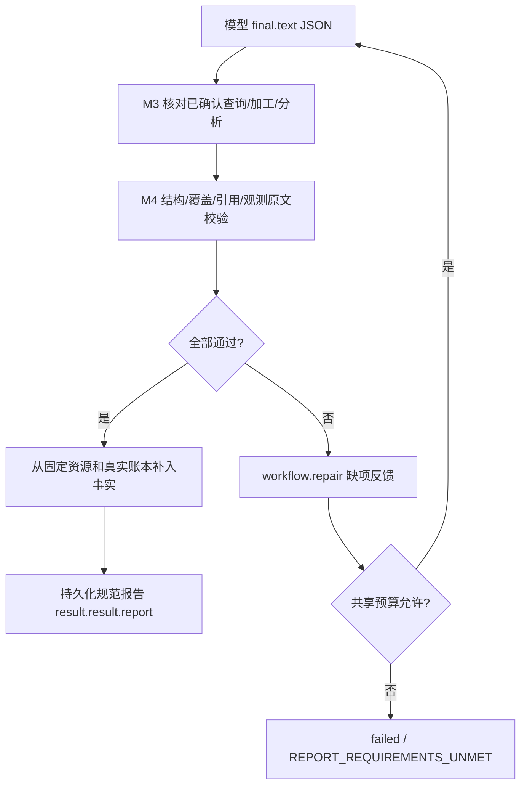

# M4 报告结构、来源引用与人工部署

M4 已实现，可以先行部署。M3 检查必需步骤真实完成，M4 进一步检查最终报告的结构、记录覆盖和来源引用，再由服务端生成规范报告。失败进入同一套有限补齐流程；不合格报告不会作为成功结果交付。

本机增量产物：`service-harness-skill/build/stage-m4/`；业务包：`forest/build/fhe-patrol-v4.zip`、`patrol-tutorial-http-v4.zip`、`patrol-tutorial-snapshot-v4.zip`。首次建议 HTTP 教程包或 snapshot 教程包二选一。摘要见 stage 的 `M4-RELEASES.json` 和 `forest/build/m4-releases.json`。stage 需合入匹配的现有部署，不能整体覆盖现场私有配置。

## 1. 包内资源与模型提交

新业务包同时包含 M3 的 workflow-requirements.json，以及以下两个 `role=resource` 文件：

- report-requirements.json：version=字符串1，format=evidence-report-v1，rules 为最多8条唯一规则，每条只含 id/path/sha256。path 必须指向固定包内资源，sha256 是原始文件字节摘要。加载时核对；改规则后必须显式更新绑定、升包版本、重新签名。
- report-submission.schema.json：平台内置 schema 的副本，校验规范摘要必须一致。正式 schema 源码位于 `service-harness-skill/contracts/report-submission.schema.json`。不能通过自改 schema 放宽宿主检查。

SKILL.md 必须写明读取这些资源并在正文说明提交结构，加载器不会自动读旁文件。不修改现有 model-decision 协议，仍提交 `kind=final`、`text=纯JSON字符串`。text 内对象如下（引用均须替换成实际工具结果）：

```json
{"schemaVersion":1,"reports":[{"skill":"fhe/patrol-tutorial","summary":"资料概述","limitations":["实际限制"],"datasets":[{"datasetRef":"真实datasetRef","findings":[{"recordIndex":0,"profileId":"describe","mediaRef":"该记录sources里的真实mediaRef","observation":"原样复制已确认answer","assessment":{"status":"not-assessed","reason":"未作正常或异常判断","ruleIds":[]}}]}]}]}
```

reports 恰好覆盖本 run 已激活的 M4 技能。datasets 恰好对应 M3 为每个查询范围选定的完整加工结果；缺失、重复、额外或其他 run 的引用都不通过。每条完整加工记录、每个必需 profile 都须有 finding；recordIndex 是完整 records 中零起始下标。相同 recordIndex/profileId 不可重复。精确去重记录可以选其任一真实来源；不同记录共用同图仍分别关联。

所有对象禁止未知字段，严格校验类型；模型不提交统计、时间、来源产物标识、置信度或人数等派生字段。observation 与对应已确认分析的 answer 逐字相同，不能润色。summary、assessment.reason 是模型生成文字，不作事实保证。status 只允许 not-assessed、review-required、normal、abnormal；normal/abnormal 必须引用获准 ruleIds。规则 ID/文件摘要正确不代表系统已证明该自然语言判断符合规则。

输入上限：final.text UTF-8 64 KiB，最多8个技能、每技能64个dataset、每dataset1024个finding，recordIndex≤1023；summary/observation 各≤4096字符，reason≤2048字符。实际还受原模型输出/上下文/执行预算约束；首次使用小批量。

## 2. 服务端生成什么



成功 `GET /runs/{runId}` 的 `result.result.report` 是 `{schemaVersion:1,format:"evidence-report-v1",reports:[...]}`。每个报告包含 skill、release、report要求文件的 requirementsDigest、summary、summarySemanticallyVerified=false、limitations、datasets。

| 输出位置 | 真实来源与含义 |
| --- | --- |
| datasets[].datasetRef/recordCount/coverage/stats/groups/warnings | 已确认加工事实，recordCount 是加工后记录数，不是人数 |
| findings[].recordIndex/record | 加工记录下标与原始规范记录，capturedAt=null 保留未知 |
| findings[].observation/payloadJson/warnings | 已确认能力返回值，结构化载荷按原值返回，不合成 count/confidence |
| findings[].citation | 真实 analysisRef、profileId/hash、analysisResultSha256、媒体ID/版本/类型/摘要、captureTimeTrust、artifactId/artifactSha256 |
| findings[].assessment | status/reason、固定资源 ruleRefs 及 semanticallyVerified=false |

原 `result.result.text` 替换为规范报告 JSON 文本镜像，普通文本前端需升级；不能把它直接当阅读用答案。M3 检查摘要仍在 `result.result.workflow`。结果持久化后重启读取同一报告，不重新执行或生成报告。规范报告总上限256 KiB，超限终止为 REPORT_RESULT_LIMIT，不静默截断记录。

事实来自 ProviderStore 与已确认成功调用、已实际完成作业的联查，同租户/用户/run/固定业务技能隔离。能力调用新增内部 source/artifact provenance，工具公开 schema 不变。模型写的同名来源文件、执行意图、失败/unknown/未确认事实均不能充当来源。HTTP 源交付前重新授权，文件沿现有 checkDelivery 检查可交付性。前端仍须按当前身份检查 run 与 artifact、原图版本和业务 ACL。

M4 不证明主模型理解用户范围正确、视觉识别准确，也不证明 summary/reason 的语义与业务规则一致。不要把 semanticallyVerified=false 显示成“已验证正常”。缺拍摄时间不补当前时间，上传仍 provider-declared。没有增加视频执行、自由代码、确定性业务规则引擎或现场验收结论。

## 3. 失败与兼容

格式失败 REPORT_FORMAT_INVALID；技能集合 REPORT_SKILL_SET_INVALID；引用错误 REPORT_CITATION_INVALID；观测改写 REPORT_OBSERVATION_MISMATCH；记录/数据集缺失 REPORT_FINDINGS_INCOMPLETE/REPORT_DATASETS_INCOMPLETE；判断缺规则 REPORT_RULE_REQUIRED；伪造规则 REPORT_RULE_INVALID。这些是 workflow.repair 内部 missing 的 code，不能当成新增 REST 路径。

M3/M4 共用业务 maxRepairs、宿主 workflow.max.repairs、executionLimits.maxRepairs/maxRounds/maxTools/maxLifetimeMillis；最多两次，重启不重置。同一个最终轮次反馈幂等。M4 包的缺项预算耗尽以 REPORT_REQUIREMENTS_UNMET 失败（包括尚缺 M3 步骤）。配置、权限、交付及尺寸错误保留各自错误码。补齐不自动重放 unknown 调用。

无 report-requirements.json 的旧包保持旧 final 行为。新版核心对不支持 M4 的旧 guard 报 REPORT_GUARD_UNAVAILABLE；无 guard 仍报 WORKFLOW_GUARD_UNAVAILABLE；不正确的资源/规则/schema 报 REPORT_CONFIG_INVALID。旧核心不认识 M4，**必须先同时更新两个 JAR，再发布 v4 包**。已运行旧 pin 不迁移，现场先 drain 再升级。

## 4. 可先行部署节点与更新顺序

1. 关闭新准入、drain 并对账未决任务；保留旧 JAR、私有配置、release、policy 和 binding。
2. 从 stage-m4 替换 `cellets/cube-service-harness-3.0.jar` 和 `libs/cube-service-harness-skill-3.0.jar`，移除重复旧副本；保留匹配 common/service/dispatcher、同 JVM Auth/AIGC/FileStorage 和 JDK8。此次不需要新 REST、DB表或 Python 协议。
3. 保留 M1/M2 Provider、普通 Runner、files/grant、模型及视觉配置。一个 Harness JVM 继续支持多个独立 model/Runner 单元，同角色可有多个，独立 workerId/实例/目录/租约。
4. 沿用 M3 配置（首次部署才安装模板到私有绝对路径），不新增配置键：

```properties
broker.completion.guard.class=cube.service.harness.skill.WorkflowGuard
broker.completion.guard.config=C:/private/harness/workflow.properties
```

私有文件内容 `workflow.max.repairs=2`，Linux 用实际绝对路径。guard 不加入 broker.providers。模板不覆盖已有私有值。

5. 重启智能体系统。四个工具公开 schema 与 M3 相同，实际获准的相同 digest 可复用。用线上批准的四个工具摘要重构、validate、RSA签名发布 v4 业务包；发布新 policy，CAS 切换绑定。两个教程模式同名技能一次只选一个。stage 只提供增量文件，不自动发布、切换或部署。
6. 业务系统接入 `tutorials/examples/render-report.js`：读取规范 report，按真实 artifactId/hash 取来源，沿已有后端认证和固定原图版本展示。老业务包仍可使用原文本页面。

**完成 1～6 即可先行人工部署跑通，不需要等待真实环境验证。**

人工顺序：启动业务系统两个只读接口（snapshot则先上传图片与JSON）→ 智能体系统与多个 model/Runner/视觉单元就绪 → 对话用户 task-profiles 可用 → 显式 skills 提交一两页小任务 → 等待 succeeded/confirmed 或明确 failed → 读取 report/workflow → 看统计、观测、判断、时间信任标记并点击原图。空资料应返回真实空dataset报告。保存版本、digest、policy target、runId、终态与现象，再讨论现场验证。

构建命令（cube-server 目录，先配置实际 JDK8）：

```powershell
ant -f service-harness/build.xml stage "-Dstage.dir=C:/releases/harness-m4"
ant -f service-harness-skill/build.xml stage "-Dstage.dir=C:/releases/harness-m4"
```

正式构包命令在 forest 目录：

```powershell
python -B scripts/build_package.py --dependency common/data=<实际digest> --dependency common/capability=<实际digest> --dependency common/time=<实际digest> --dependency common/processing=<实际digest> --version 4 --output build/fhe-patrol-v4.zip
```

教程循序步骤见 [第10章](../../tutorials/src/content/docs/guide/10-report-and-citations.md)。本地回归使用实际 JDK8，覆盖核心协调器持久化/恢复/预算、真实 SQLite/Broker/签名发布和报告引用，以及结构/覆盖/规则/时间边界；视觉调用使用明确夹具，不记作真实推理。现场尚未部署，验收登记继续保留 not-run。
