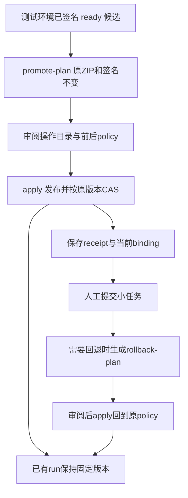

# M5 同包晋级、CAS 切换与可恢复回退

M5 已补齐管理操作工具、循序教程和本地回归，可以先行人工部署。测试环境通过的候选 ZIP 原样带到正式环境，保持 manifest digest；发布 policy 后用固定 expectedVersion 做 CAS。晋级、回退均只影响后续新建任务，已有 run 保留创建时的完整 pin。

本阶段复用现有签名发布、不可变 policy、CAS 幂等回执和 RunSelection，不增加 REST、数据库表、Python 协议或生产 JAR 代码。M4 已部署者只更新管理工具；不用再次替换相同 JAR，也不用为了阶段编号重构业务包。首次安装仍先完成 [M4](M4.md)。一个 Harness JVM 接多个独立 model/Runner 的部署方式不变。

## 1. 交付与部署节点

- 源码：`tutorials/examples/release_ops.py`，配套 `agent_client.py`；Python 3.11 标准库，无新增依赖。
- 配置模板：`tutorials/examples/config/promotion-source.example.json`、`promotion-target.example.json`。
- 独立管理工具包：`service-harness/build/stage-m5/`、`stage-m5.zip`，摘要和复用基线见包内 `M5-RELEASES.json`。
- 教程：[第11章：晋级与回退](../../tutorials/src/content/docs/guide/11-promotion-and-rollback.md)。

在 cube-server 目录可重新准备交付目录，输出目录必须不存在：

```powershell
python -B service-harness/scripts/stage_m5.py
```

此脚本核对本机 M4 JAR 与 v4 业务包摘要，打包管理工具，不构建、不部署、不调用远端。生成清单不代表已在现场验收。独立工具 ZIP 中不含 JAR、业务 ZIP、签名私钥、token 或现场配置；候选包和签名由发布方提供。

**已有 M4 环境：复制管理工具、填写两个配置、准备目标原 policy 后，即可先行部署并人工操作。** 无需停 JVM，也不需要更改业务系统两个只读接口和报告页面。尚未安装 M4 时，按 M4 的两个 JAR、guard、Provider、工具、业务资源和页面顺序部署，再进行本章升级。

## 2. 操作约定



`promote-plan` 查询源/目标 release、binding，调用只读的 packages/validate；不发布 release/policy，不改 binding。源包须已签名、算法 SHA256withRSA、ready，目标依赖与原 policy 所有 release 须 ready。计划将原始 ZIP、签名、完整原/新 policy、原 binding 版本、目标地址/租户和操作 ID 保存到新目录。文件摘要与 planSha256 检出意外修改，不代替操作账号权限或加密签名。

原 policy 必须由管理员提供完整 JSON，包含 schemaVersion、kind、id、version、permissions、skillReleases、businessLimits。现有 REST 无 GET policy 定义；binding 只能读 target/version。plan 核对版本，apply 用不可变 POST 再验证原 policy 内容一致后才继续。M5 用于已有 release 的部署升级，初次空环境沿教程第4章操作。

晋级保留原权限、无关 release 和配额，合入候选所需权限及锁定依赖。同名业务包须显式指定被替换的旧 digest；若工具依赖升级导致同名工具冲突，先由管理员单独准备兼容的目标基线，不静默移除其他技能或工具。

配置中的 tenant 是预期 Cube domain ID，不是任意业务环境名。token 从 tokenEnv 指定的环境变量读取，服务端 release 的 tenant 会被核对；apply 在任何写操作（包括恢复 CAS）前重新核对目标租户。保持相同租户、操作 subject 和原配置恢复请求；更换 token 值可以，身份不能换。URL 不得含账号密码。正式环境与测试环境可以使用不同服务，也可以在同一服务使用隔离租户。

目标须预先批准签名 keyId，具备 release/policy/binding 管理权限；依赖、Provider、runtime、实际模型/Runner、source、grant、origin/path 与私有 secret 分别在环境中配置。相同逻辑 sourceRef 应映射各环境相应业务地址；改业务包内容会改变 digest，须作为新候选重新签名，不能称为原包晋级。

## 3. 应用、恢复和回退

教程第11章给出从配置到命令的完整例子。操作目录结构：

```text
promotion/
  plan.json
  package.zip
  signature.txt
  policy-before.json
  policy-next.json
  receipt.json       # apply期间原子落盘
  .apply.lock        # 操作系统文件锁，进程退出即释放
```

`apply` 使用 operationId 派生固定的 `.base/.validate/.release/.policy/.bind` 幂等键，读取固定文件；CAS body 始终是计划中的 target 与 expectedVersion。发现过期 binding 且此前未尝试 CAS 时停止，不写远端。CAS 前先持久化 bindAttempted；响应丢失或进程退出后，重跑同目录、同配置、同 apply 命令，重放原请求取得原回执。不会改用最新 version 强制切换。

receipt 的 status=active 表示读取时仍是该次绑定；superseded 表示历史操作已成功，但当前绑定已被后续切换替代。重放原晋级回执不能撤销后来回退。网络错误时保留整个目录，不换操作 ID、不改文件、不直接删除锁文件。OS 锁已随进程释放；并行 apply 会拒绝。若未确认 CAS 的请求实际发生版本冲突，恢复仍返回冲突，须人工核对并生成新计划。

`rollback-plan` 只接受已有确认绑定回执、且仍是当前 binding 的晋级操作。它保存当前版本和原 policy，另建独立目录；审阅后 apply 才切换。旧包和其依赖必须仍 ready、原 policy 保留。回退前已有 candidate run 仍用 candidate pin，后续新 run 才取原版本。安全撤权、source ACL、release draining/退役仍按现有授权规则执行；pin 不保证任何任务绕过当前权限继续运行。

人工跑通顺序：

1. 测试环境已有签名 ready 候选，准备目标旧 policy、原 ZIP 和原签名。
2. `promote-plan` → 审阅 ZIP/digest、目标租户、前后 policy 与配额。
3. `apply` → 保存 receipt，确认 status=active 和当前 binding。
4. 用正式对话用户提交一两个小任务，保留 runId 与报告；此处即可先跑通，不等现场验收。
5. 需要演练回退时 `rollback-plan` → 审阅 → `apply` → 再提交小任务。
6. 保留两份操作目录和实际运行现象，再讨论真实环境验证。

## 4. 本地检查与边界

实际 JDK8 的 `ant -f service-harness/build.xml test-execution` 已通过，新增 ReleasePromotionTest 用真实 RSA 签名、PackageRepository、RemoteAdmin、SQLite、CatalogStore 和生产 ProfileRegistry，覆盖跨租户同 digest 发布、不自动激活、并发 CAS 仅一方成功、同键异请求冲突、回退和历史 ACK 重放、旧 run 完整 pin 与重开存储。

`python -B examples/check_release_ops.py` 覆盖本地 HTTP 晋级/回退、原 ZIP 保留、策略合并、丢失发布/CAS 回应的恢复、过期操作、租户检查、依赖缺失、同名冲突、策略副本不符、篡改与并发本地锁。HTTP 使用协议夹具，真实签名由 Java 测试覆盖；不调用真实业务系统或模型。

这些是实现和本地回归结果。现场未部署，`forest/packages/fhe-patrol/cases.json` 的 P20 与其他现场项保持 not-run。M6 的真实质量、样本和跨场景验收尚未执行，不作为此次人工部署的前置条件。
