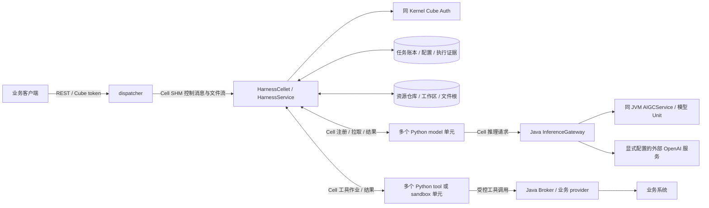

# Harness 服务与部署

`service-harness` 负责受理 AI 任务、固定执行配置、组装上下文、调度模型与工具、保存结果和恢复证据。正式入口为 `cube.service.harness.HarnessCellet` / `HarnessService`，Cellet 名称为 `Harness`；产物 `cube-service-harness-3.0.jar` 放入 `cellets/`，由 Cell Kernel 管理启停。

## 文档入口

| 文档 | 内容 |
| --- | --- |
| 本文 | 服务组成、数据流、构建和部署步骤 |
| [REMOTE-NODES.md](REMOTE-NODES.md) | 一个 Java 服务接入多个跨机器 Python 单元的配置示例 |
| [服务器执行配置](config/harness-execution/README.md) | 全局模型、运行时、工具集、执行预算与生效规则 |
| [租户业务策略](config/harness-tenant/README.md) | 技能、权限和业务配额的初始化与管理 |
| [TRANSPORT.md](TRANSPORT.md) | dispatcher REST、SHM 消息与文件传输 |
| [EXECUTION.md](EXECUTION.md) | 模型推理、资源循环、多单元容量和结果对账 |
| [RUNTIME.md](RUNTIME.md) | 技能包发布、固定配置、权限、工作区和上下文 |
| [TOOLS.md](TOOLS.md) | 可信工具、业务 provider 与 sandbox Runner |
| [CONTROL-FILES.md](CONTROL-FILES.md) | 输入、审批、取消、附件、产物和自动清理 |
| [STORE.md](STORE.md) | SQLite/MySQL 配置、自动建表、任务账本及恢复 |
| [RESILIENCE.md](RESILIENCE.md) | 接单开关、drain、停机、升级及故障处理 |
| [TRACE.md](TRACE.md) | 诊断导出、反馈和离线回放 |
| [CONTRACT.md](CONTRACT.md) | 协议、注册租约、幂等和兼容规则 |

业务 REST 的完整定义见 [API 文档](../docs/rest-api/src/harness/README.md)。客户技能教程与示例位于工作区 [skill/](../../skill/README.md)。

## 服务组成与数据流



1. dispatcher 将原始 Bearer 和请求正文经 SHM 交给 Harness；服务用 Cube Auth 校验 token，以 domain/contactId 隔离租户与用户。
2. 服务器从 `config/harness-execution/` 加载全部模型和执行器；新租户从 `config/harness-tenant/default.json` 初始化业务策略。客户端通过 `GET /harness/v1/task-profiles` 查询能力，在 `POST /harness/v1/runs` 中独立选择模型、执行器和技能；工具由服务端根据技能、权限和执行器计算，请求不支持 `tools`。创建时固定实际配置和授权，提交后返回 202 与 `selection`。
3. Coordinator 根据账本组装上下文、保存执行意图，再选择健康且有可用容量的 Python model 单元。Python 负责模型协议适配，通过 Cell 请求 Java 推理网关；模型地址和密钥由 Java 管理。
4. 模型决策经 Java 校验后执行资源操作、派发受控工具、等待用户/审批，或提交最终结果。普通模型文本中的代码不会自动执行；动态代码须使用专门配置的 sandbox 链路。
5. Java 提交事件、结果及实际用量，客户端通过 dispatcher 查询或续读有限 SSE 页。文件控制使用 SHM 消息，文件字节使用同一节点、同一会话的原生流。

一个 JVM 支持多个 model/runner，包括多个同角色单元。每个 Python 进程必须独占 workerId、runtimeDir、实例身份、journal 和租约；Java 按角色、能力、健康及实际空闲容量调度。共享物理模型后端使用同一 backendId 计容，新增 worker 不会增加该后端的物理容量。

## 环境与构建

Java 构建和运行必须使用 **JDK 8**，构建工具为 Ant。Python Harness 工程为配套的 `apexnova-wisdom`，使用 Python 3.11 并安装其 `harness/requirements.txt`。

从 `cube-server/` 执行：

```powershell
# 按需构建服务及配套 common/dispatcher 产物。
ant build-service-with-harness-release
# 生成独立发布目录，目标必须是专用 staging 目录。
ant "-Dharness.stage.dir=C:/releases/cube-harness" deploy-with-harness
```

联合发布使用已构建的其他服务产物；首次完整发布可先执行 `ant build-with-harness`。单独构建本模块时，从 `service-harness/` 执行：

```powershell
ant "-Dcommon.jar=C:/build/cube-common-3.0.jar" build
ant "-Dcommon.jar=C:/build/cube-common-3.0.jar" "-Dstage.dir=C:/releases/harness-only" stage
```

本模块 `stage` 提供 Harness JAR、配置模板、服务器执行 JSON 与租户策略 JSON、Cell XML、运行及诊断脚本；独立发布还须补齐配套 `bin/cell.jar`、`libs/cube-common-3.0.jar` 和依赖。`stage` 只复制文件，目标不要指向运行目录。

## 主配置与运行方式

将 [harness.properties.template](config/harness.properties.template) 复制为服务工作目录下的 `config/harness.properties`，填写私有值。默认无需 JVM 参数；`-Dharness.config=<文件路径>` 可显式覆盖主配置路径。Java 相对路径按服务工作目录解析。配置目录由运行账户独占，密钥不提交到源码库。

| 部署项 | 配置位置与要求 |
| --- | --- |
| worker 接入 | `worker.credential` 至少 24 字符；逐个设置 `worker.<workerId>.role`，模型另配 model/backend，Runner 按类型配置容量 |
| Cell 地址 | 实际加载的 Cell XML；独立模板默认 `127.0.0.1:7600`，合部署示例为 6000 |
| 健康/运维 | `http.host=127.0.0.1`、`http.port=7088`；只允许 loopback |
| 任务执行 | `store.enabled=true`、`execution.enabled=true`，按 [STORE.md](STORE.md) 补齐专用数据库配置 |
| 服务器模型/执行器 | `execution.profiles=./config/harness-execution`、`execution.model=Baize@1`、`execution.runtime=resources@1`，修改后重启，作为请求省略选择时的默认值 |
| 租户默认业务策略 | `execution.tenant.templates=./config/harness-tenant`；完整复制本目录，逐字段说明见[配置文档](config/harness-tenant/README.md) |
| 模型推理 | Java 配置 `worker.<id>.model/backend`、`backend.<id>.*` 和稳定唯一的 `inference.node.id` |
| 可选功能 | 文件、工具、审批、trace 及反馈按对应文档显式启用 |
| 接单 | 新部署先设 `execution.accepting=false`，完成就绪检查后用独立管理凭据开启 |

默认模板关闭存储和执行，只提供 scripted 通信探针；仅复制模板不能执行正式任务。

**合部署**用于已有 Cube 用户的业务 REST：将 JAR 放入宿主 `cellets/`，把 [cohost-cellet.xml](config/cohost-cellet.xml) 合入宿主 Cell XML 的 `cellets`，端口与宿主 Talk 一致，保留原 `ServiceCarpet`。联合 staging 提供 `config/service-with-harness.xml`，由宿主启动命令显式选择。Harness 向同一 Kernel 注册服务，复用 Cube Auth；默认 Unit 推理还需要同 JVM AIGCService 和对应模型 Unit 就绪。

**独立 Cell**使用 [standalone.xml](config/standalone.xml) 生成的 `cell.xml` 和 `HarnessCarpet`。其中没有 Cube Auth / AIGCService，业务请求返回 `AUTH_UNAVAILABLE`，默认 Unit 后端未就绪；适用于 worker 接入与独立联调。

```powershell
# 主配置已放入发布目录 config/harness.properties。
./scripts/run.ps1 -Stage C:/releases/harness-only -StopFile C:/private/harness/cell.stop -Java C:/jdk8/bin/java.exe
```

Linux 对应 `sh scripts/run.sh /absolute/stage /absolute/private/cell.stop`，可设置 `HARNESS_JAVA`。脚本前台运行，可交由 supervisor/systemd 管理。Cell 从工作目录读取 `cell.xml`；多个实例须使用不同目录、端口和停止文件。

## dispatcher 与 Python 单元

在现有 `dispatcher.properties` 启用 `harness.rest.enabled=true`，把 `Harness` 加入 `cellets` 和对应 `director.N.cellets`；`director.N.address/port` 指向 service 的 **Cell 端口**。业务客户端配置 dispatcher HTTP 地址，健康探针配置 service HTTP 地址，Console 地址独立配置。

Python 单元主动连接 Java Cell。每个 workerId 在 Java 中单独授权，Python 的 `workerCredential` 与 Java `worker.credential` 一致；用户 token 和模型上游密钥不下发给 worker。可按 [REMOTE-NODES.md](REMOTE-NODES.md) 在不同机器上部署多个同角色单元。

## 就绪检查

1. 检查 service `/healthz`，确认健康 HTTP 可用；它不证明 worker、Auth 或模型已就绪。
2. 启动各 Python 单元，确认独立的 registered/ready 状态。Java 记录 register/describe、drain、unregister 的身份和结果；正常心跳不重复打印，日志不含凭据和 sessionId。
3. 用有效 Cube token 查询 dispatcher `/harness/v1/capabilities`，确认所选模型的 runsReady、worker、后端容量及接单状态。模型/执行器变更作为请求省略选择时的默认值。
4. 开启接单，以唯一 `Idempotency-Key` 和 `{"input":{"instruction":"请简短介绍自己","attachmentIds":[]}}` 创建任务，查询 run/events 至终态；使用文件或业务工具时分别检查完整上传、结果与下载链路。

停机和升级按 [RESILIENCE.md](RESILIENCE.md) 执行，保留任务账本及 Python journal，直到在途执行全部对账完成。
