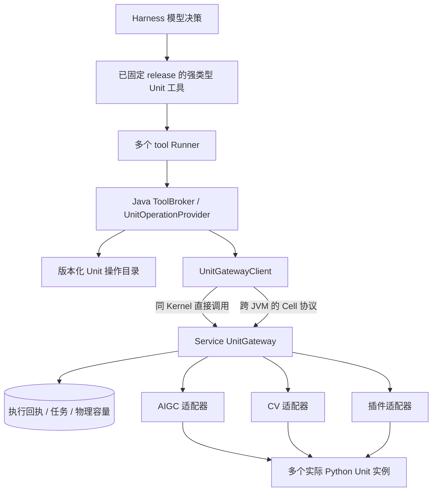

# 全量 Unit 的 Harness 工具接入方案

本文规定将现有全部 Unit 的业务操作接入 Harness 的目标架构、配置契约、实现顺序和交付条件。[操作目录与公共契约](../common/unit-tools/README.md)提供已落地的描述和接口；本文的网关执行链路、新工具及配套配置仍按下述方案实现。实际可执行的工具以 [TOOLS.md](TOOLS.md) 和 [通用工具包](../service-harness-skill/README.md) 为准。

目标是让业务开发者通过统一的 Harness 契约使用全部受支持的 Unit，把主要精力放在业务系统的数据、规则、工作流和结果集成。采用“统一能力目录、统一调用网关、按操作生成强类型工具”的实现方式。能力名称可以明确选择，实例调度和部署位置由平台内部处理。

## 业务开发者接入契约

开发者不需要也不能被要求感知 Harness 与 Service 是同 JVM 还是跨 JVM。该要求约束 API、SDK、工具 schema、业务包配置、结果与错误、教程和示例；仅在文档中隐藏术语不能算作实现透明接入。

| 参与方 | 负责内容 |
| --- | --- |
| 业务开发者 | 配置统一 Harness 业务地址和身份凭据，准备业务接口/数据/文件，选择逻辑能力或业务 profile，编写业务规则和工作流，提交任务并处理结果、事件及审批 |
| 平台部署与运维人员 | 安装 Unit/Provider、发布并授权工具、配置内部网关/传输、认证、资源池、实例、文件服务和故障诊断 |
| 平台实现 | 根据私有部署配置自动完成发现、路由、参数适配、文件传输、多实例调度、状态恢复及对外结果投影 |

对业务开发者提供一个稳定的业务入口和一套调用方式。业务 API、SDK 和工具参数不出现 `local/remote`、transport、gatewayId、JVM 位置、Kernel、Cell 地址、workerId、实例身份或宿主路径等部署选择；业务开发者无需直连 Service 或 Unit，也无需安装 Java Provider 或选择内部通信方式。平台管理员按业务需要提供已发布、获准的工具，业务包只声明逻辑能力、输入输出和业务约束。

任务提交、文件上传、状态查询、事件读取、取消、审批和产物下载沿用统一的 Harness 业务契约。`runId`、`executionRef`、文件引用等按不透明标识使用，不编码需要开发者解析的节点或传输信息。能力目录、工具描述和普通错误只展示逻辑能力、业务参数、可用状态与可采取的操作；物理实例、路由和通信诊断保留在受权运维接口中。

部署位置、实例数量或内部传输变化时，业务系统代码、SDK 调用、业务包及工具契约无需修改；统一入口通过平台路由保持稳定。能力权限、媒体限制、超时、幂等和结果语义按同一业务契约执行，不能要求开发者按部署方式编写分支。涉及不确定执行时，平台返回统一状态和查询方式，业务开发者不承担跨节点重放或物理执行对账。

## 开放范围与完成定义

“所有 Unit 已开放”指交付清单中全部正式 Unit 的公开业务操作都有可发布、可授权、可执行、可对账的 Harness 工具。覆盖文本、图像、音频、视频、知识处理、CV 端点和插件单元；包括正式声明的查询、计算、业务写入和会话控制。初始化、模型加载、内部回调、注册、心跳等生命周期函数由服务管理。

平台部署时自动登记全部已安装、受信的操作描述，并生成相应工具包。租户和用户的调用范围仍由业务权限决定。管理员不再为每种 Unit 修改 Harness 核心代码，也无需维护 Provider 和 AIGC 两份重复的 Unit 允许名单。

完成条件同时包括：

- 全量清单中的每个 Unit、每个公开业务操作都绑定明确的操作描述、Service 适配器和工具；新增插件遵循相同契约。
- 工具能够通过真实 Service 路径到达该 Unit，文件、结构化结果、长任务及实际用量可以返回并对账。
- 同名 Unit 的多个实例可以共同承载请求，共享物理模型的不同入口统一计容。
- 同 JVM 和跨 JVM 的 Harness 到 Service 调用均有完整链路；跨机器文件通过受控传输交付。
- 同一份业务集成代码、业务包和请求可用于不同内部部署方式，公开 schema、SDK 配置及结果无需添加部署分支。
- 无权限、未部署、未就绪、繁忙和协议不兼容分别有明确状态，不能把“返回未实现”计为完成接入。

“工具已开放”“部署实例就绪”“某租户获准调用”分别展示。未安装模型的环境可以查看已交付的工具定义，但不宣称具备对应推理能力。

## 现有实现与需要补齐的部分

| 现有能力 | 实现依据 | 本方案的改造 |
| --- | --- | --- |
| 单图工具按业务 profile 选 Unit | `CapabilityInvokeProvider`、`AnalysisProfiles`；仅接受 OmniMultimodal、OmniPerception、SpecializedDetection 的固定组合 | 保留旧入口，底层转入统一网关；新操作由目录和 schema 声明 |
| Harness 已能调用 Service | `ProviderInvocation.invokeMedia` → `AIGCService.invokeMedia` → `HarnessMediaBridge` | 扩展为支持多种输入、输出及执行模式的通用接口 |
| 多种 Service 方法和协议 | `AIGCService`、`CVService`、`PluginUnitInvoker` | 通过适配器接入；补齐显式选中实例、物理回执和恢复接口 |
| 工具包与 Provider schema 精确匹配 | `QueryProviders`、`ToolBroker`、包 manifest | 由同一操作描述生成 schema、Provider 绑定和签名工具包 |
| 当前工具只允许 read-only | `package-manifest.json`、`PackageRepository`、`ToolBroker.enqueue` | 增加业务写入、会话控制及对应审批和结算契约 |
| 有媒体预留、推理账本和插件容量管理 | `ProviderStore`、`InferenceStore`、Service 内现有调度器 | 统一物理容量归属，避免不同入口重复占槽或绕开占用 |
| 普通工具有等待上限 | 默认 30 秒；协商 `provider-await-v1` 后最长 290000 毫秒 | 有限调用继续使用既有等待；长作业和视频会话使用持久任务 |
| 文件产物主要为文本 | `FileService`、`ProviderInvocation.textArtifact` | 增加二进制输入/产物、受控传输和大结果引用 |

配套 Python 工程的 `cube/unit_registry.py` 当前登记 14 个内置 Unit；`wire_names` 为空的单元使用专门的服务属性和 Action，不能假定统一调用 `execute()` 就能覆盖。另有 CV Service 端点和插件注册表。

Python `cube/aigc_service.py` 的 `executeTextToImage` 当前为空实现；源码中的 `ChatUnit`、`SummarizationUnit`、`ObjectDetectionUnit` 等历史类也不能仅凭文件存在算作正式可用 Unit。实现时必须逐项核实启动注册、公开操作和真实执行路径：正式保留的能力补齐实现与注册，退役能力明确记录归属和替代入口，不自动映射到语义不同的模型。文生图不作为已有能力承诺；若要纳入正式交付清单，须同时交付实际生成单元。

## 全量接入清单

以下是必须展开成逐操作清单的现有能力范围，操作名以实际实现和校验后的描述为准。

| Unit / 端点 | 需接入的业务操作 | Service 接入方式与补齐项 |
| --- | --- | --- |
| Baize、Baize2 | 文本/结构化生成及已有生成参数 | 复用 CompletionProvider；工具子调用独立计账，仍受 run 总预算约束 |
| OmniMultimodal | 已支持的文本、多图等多模态理解 | 多模态适配器；逐项登记输入媒体和参数，不继承其他 Unit 的能力 |
| OmniPerception | 已实现的单图感知任务、视频会话及 status/update/stop | 多模态适配器；按任务 schema 和实际运行报告校验 |
| OmniGround | 定位、检测、点选等已支持任务、视频会话及 status/stop | 多模态适配器；保留坐标、类别和原始结构化结果 |
| OmniVL | 视频理解、已有多模态处理、会话 start/status/update/stop | 多模态适配器；视频文件、实时流和结果事件进入持久任务契约 |
| SpecializedDetection | 已支持的图片检测 profile、切片、视频 start/status/stop | 复用专项检测契约和能力报告；profile/classes 必须真实支持 |
| Embedding | 向量编码、语义检索、重排及已正式提供的检索操作 | 检索复用现有 Service；向量编码等尚无公开入口的操作补受控 Service Action |
| Speech | 自动语音识别及正式提供的音频预处理 | 语音适配器；传入受控音频引用，返回真实识别结构 |
| Audio | 说话人分割及关联的音频分析 | 音频适配器；显式声明 Speech 等依赖和共享容量 |
| FacialExpression | 表情识别及可视化结果 | 复用 Service 识别路径，图像和可视化文件走受控产物 |
| KnowledgeBase | 知识生成/检索、文档与文章激活/释放、批量操作、备份、删除等正式操作 | 知识适配器；按知识资源 ACL 和读写权限分开授权 |
| Spider | URL 内容提取及正式声明的解析操作 | 抓取适配器；沿用获准来源契约，输入使用 sourceRef 等受控引用 |
| Psychology | 已实现的绘画检查、绘画/指标预测、语音情绪等公开操作 | 复用对应 Service 入口；按实际依赖校验 CV、文件和模型就绪 |
| CV Service | 条码识别/合成、目标检测、姿态、手部关键点、裁纸、相似度 | CV 端点适配器；为现有端点补能力报告、实例路由及物理回执 |
| 插件 Unit，现有 OmniForest | 插件正式声明的全部业务 Action；OmniForest 包含树冠检测 | 复用插件注册和调用器，补操作 schema、描述摘要及统一执行身份 |

逐操作清单至少包含 `unitName`、公开操作、来源实现、适配器、输入/输出 schema、执行模式、权限、effect、依赖、工具名、协议回归用例。静态内置注册、Python Action 注册、CV 业务入口、插件声明和运行时能力报告交叉核对；无描述的正式操作直接导致覆盖检查失败，不能静默跳过。

## 调用架构

下图描述平台内部实现。业务系统始终通过统一 Harness 业务入口接入，图中的网关和传输分支不成为开发者的集成步骤。

Harness 保存 run、工具意图、授权和结果确认。Service 网关负责目标实例选择、物理派发、Unit 状态、物理资源预留及回执。适配器负责将已校验参数转换为已有 Service/Unit 协议，并恢复真实结果。

Harness worker 与模型 Unit 保持不同身份体系：前者继续使用独立 workerId、instanceId、runtimeDir、journal 和租约；后者在现有 contact/连接身份之上增加进程 incarnation 和能力报告版本。一个 service-harness JVM 可接多个 model/runner 和多个 Service 网关，每个网关可接多个同名或不同能力的 Python Unit。

### 操作目录与适配器

新增公共契约包 `cube.aigc.unit`，核心对象为 `UnitOperationDescriptor`、`UnitGateway`、`UnitExecutionRequest`、`UnitExecutionReceipt`。契约使用 Java 8 和 JSON，不引入模型框架到 Harness。

| 描述字段 | 约定 |
| --- | --- |
| `operationId`、`version`、`descriptorDigest` | 稳定操作身份、不可变版本及规范化摘要；不包含地址、JVM 位置、实例数量等部署状态 |
| `unitName`、`adapterId` | 精确能力名称与受信适配器；适配器不由模型指定 |
| `inputSchema`、`outputSchema` | 业务参数/结果的完整受限 schema，与现有 Contract 支持的子集一致 |
| `executionMode` | `sync`、`job`、`session`；声明开始、查询、更新、停止等操作之间的关联 |
| `permission`、`effect`、`approval` | 每个操作固定的权限、操作类型、审批要求 |
| `inputMediaTypes`、`outputMediaTypes`、`limits` | 文件类型、字节/像素/时长、批量数量、等待与资源上限 |
| `dependencies`、`resourceRequirements` | 所需服务/操作和物理资源需求，支持复合操作 |
| `usageKind`、`resultProjection` | token、图像、音频时长等实际用量类型，以及结果投影规则 |

静态描述由安装的受信代码和平台审核的描述文件提供；Python 状态报告只声明实际支持的操作摘要、就绪状态和容量。运行时注册不自动安装 Java 类，不自动采纳任意 schema 或扩大租户权限。

内置单元使用同一目录源码生成 Java/Python 契约、Provider 注册和工具包。插件安装时提供相同的操作描述；适用已有协议的插件复用通用插件适配器，需要新协议的插件随部署安装新的 Service 适配器。新增 Unit 无需修改 Harness 核心的名称枚举或 if/else。

目录中的定义与实时状态分离：定义按版本固定，状态包括 registered、initializing、ready、busy、draining、failed、stale。报告带实例 incarnation、递增序号、活动执行 ID、接收时间和有效期；过期、重连未重新就绪或摘要不兼容的实例不接新任务。

### 工具发布与发现

采用“每个公开操作一个强类型工具”，统一由 `UnitOperationProvider` 执行。工具的 brokerOperation 固定到目录操作，模型只填写该操作的业务参数和逻辑能力约束；工具 schema 不接受部署位置或物理路由选项。例如：

| 技能包 | 工具示例 | 固定操作 |
| --- | --- | --- |
| `units/omniforest` | `units.omniforest.detect` | `omniforest.detect.v1` |
| `units/omni-ground` | `units.omni-ground.analyze` | `omni-ground.analyze.v1` |
| `units/speech` | `units.speech.recognize` | `speech.recognize.v1` |
| `units/knowledge` | `units.knowledge.activate-document` | `knowledge.activate-document.v1` |

生成工具包时固定 schema、权限、effect、描述摘要和 SDK 薄入口，经现有签名发布流程发布。按 Unit/操作组拆包，遵守现有每包 32 工具、64 KiB 等限制。Provider 工厂从同一目录批量创建实例，扩展现有 `QueryProviders` 的工厂注册能力；不用给每个操作编写一个类或一套私有配置。

增加 `common.unit.list`、`common.unit.describe` 用于按媒体、任务和 Unit 名发现当前 run 获准的工具、参数及就绪情况，目录大时分页。列表返回已固定候选 release 中的技能名，模型按需 `skill.activate`，避免把全目录同时放进上下文。

任务创建时固定授权候选工具 release、描述摘要和策略版本；物理实例到实际派发时再选。运行中的新目录和新插件不会扩大旧 run 的工具范围。发现接口应同时区分“该操作有工具”“当前环境就绪”“当前用户可调用”；不向用户泄露其他租户的资源或私有部署细节。

候选目录使用独立的有界分页存储和快照引用，模型每轮只接收已激活且符合工具数量/上下文字节预算的操作组。同步核对 tenant-policy、run pin、模型 tools、Runner 消息和包大小的限制；目录规模不能靠提高单条消息上限解决。激活超额时给出明确结果，不静默丢弃已固定工具。

就绪预检按本任务实际必需的操作和依赖计算。目录中其他可选 Unit 离线不阻塞文本或已就绪能力的任务；业务工作流声明的必需操作继续严格预检。需相应调整 `ToolBroker.businessReadiness`，避免把“装了全部工具包”误解为“创建任何任务都要求全部模型在线”。

`SKILL.md` 正文直接写明用途、输入来源、实际工具调用方式及结果解释规则；旁边的脚本只在 Harness 显式执行工具时运行，不能依赖原正文加载器自动读取引用或执行模型代码。

### 逻辑能力选择与内部实例调度

默认由工具绑定的 `unitName` 和操作能力筛选实例，再按健康、drain、共享资源和实际剩余容量调度。业务 profile 可固定 Unit、参数默认值和范围；通过新增 `unit-profiles.json` 表达，作为对目录操作的受限别名。

业务开发者可以选择逻辑 Unit 名称或业务 profile，选择含义是使用哪种能力；物理部署位置和实例由平台解析。标准业务工具和 SDK 不暴露 `target.instanceRef` 等物理目标参数。

运维诊断确需固定实例时，在独立管理接口使用服务端签发的实例引用，内部绑定 gatewayId、unitName、instanceId 和 incarnation，不进入普通业务工具包和开发者教程。诊断指定实例不可用时返回具体错误，不静默换到其他实例。正常调用可以在物理派发前重新选择实例；派发后结果未知时保留原目标。

旧 `analysis-profiles.json` 保持原格式与含义，通过兼容转换获得相同操作描述；既有业务包、profileId、mediaRef 和来源证据继续有效。

## 身份、权限与操作类型

新增包格式分支 schemaVersion=7，明确声明 Unit 操作绑定、描述摘要、`effect` 和审批要求。保留 schemaVersion=6 的既有 read-only 分支，旧版本工具不自动获得新操作。

| effect | 使用范围 | 执行要求 |
| --- | --- | --- |
| `read-only` | 纯查询、生成/分析，以及仅写入当前 run 私有产物的计算 | 操作权限、资源 ACL、配额和实际用量校验 |
| `write` | 知识激活/释放、删除、持久业务数据变更等 | 独立写权限，按策略审批；不可逆/删除类操作要求审批 |
| `session-control` | 持续视频/音频会话的启动、更新、停止 | 会话归属、时长/成本限额、允许来源和生命周期控制 |

`PackageRepository`、`RunSelection`、`ResourceTools`、`QueryProvider` 注册元数据、`ToolBroker`、Coordinator 和 Runner grant 一并适配。每个工具的 effect/权限固定，不能把写操作封装在通用 read-only 工具的任意 action 参数中。

授权取安装目录、服务器策略、租户策略、用户身份、固定 release、操作权限和资源 ACL 的交集。调用前、派发前与恢复控制时重查吊销；租户/用户从可信上下文派生。操作描述、参数、资源引用、目标约束和审批结果一起绑定到调用摘要及 grant。审批继续复用当前同租户审批人与参数摘要规则。

部署侧的全量工具导出由目录统一管理，实际接入仍须满足本文的执行与对账条件；私有策略配置哪些操作可供哪个租户使用。旧 `capability.allowed.units`、`harness.media.units` 和 dedicated 开关通过迁移器转换为新策略与资源绑定，迁移结果保持原授权范围；需要全量使用的租户再由管理面配置相应权限。

## 执行、长任务与恢复

网关提供 `listOperations`、`describeOperation`、`submit`、`queryExecution`、`readEvents`、`cancel` 等平台内部契约，不作为业务开发者另行对接的接口。普通工具使用 submit 后有界等待；长作业与会话由操作工具创建持久执行，返回受控 `executionRef`。

一次调用保存 tenant/subject/run/call/job、原 fence、operationId/version/descriptorDigest、参数与输入摘要、目标约束、gatewayId、实例/incarnation、requestId、serviceSn、截止时间和资源预留。逻辑工具状态与物理执行状态分别记录。

网关接收绑定调用意图的短期授权，验证允许的租户/操作、原 fence、期限及撤销信息；不能仅凭调用方填入的 tenant/subject 获得权限。执行接管只允许对账原意图，新的派发仍需当前有效授权。

1. Harness 提交调用意图及审批证据，经认证的网关收到相同 requestId 和摘要时返回原受理结果，异摘要冲突。
2. 网关先保存执行记录与资源预留，再选定实例并持久记录物理派发窗口，随后调用适配器。
3. Unit 返回物理结果，网关保存回执、结构化结果、文件和实际用量，再向 Harness 交付。双方 ACK 丢失只重传已保存证据。
4. 超时、断连、取消受理或租约过期不证明物理结束；没有终止证据时标记 unknown，保留物理预留，不能自动改投其他实例。
5. 进程或网关重启后按原 executionId/requestId 查询和对账。旧 Unit 不具备查询/幂等协议时保守隔离未知执行；补齐持久执行日志后才允许依协议恢复，不能承诺所有旧协议都能 exactly-once。

有限 job 由 Coordinator 挂起等待，后台轮询/事件消费不占用模型轮次和工具次数；工具受理回执不能充当分析完成证据。查询和取消操作必须校验 executionRef 的租户、主体、原 run 和操作归属。

会话启动成功表示会话已创建，物理会话及资源继续独立记账。status/update/stop 固定到原实例；停止回执必须证明会话结束。默认会话隶属原 run，到 run 取消、到期或结束时发起停止并对账。持续会话必须设置最大时长、空闲期限、事件/文件/成本限额；协议范围内不提供脱离 run 的无限后台任务。

事件使用单调序号、分页 cursor、ACK 与有界背压。重新订阅可续读，重复事件去重。发送窗口未知、结果写入失败和事件 ACK 丢失均不得触发第二次业务执行。实际用量按 executionId 与分段 ID 结算一次；工具子模型和主模型共享 run 总预算，缺失的实际用量标记未知。

## 多实例与共享物理容量

Service 网关作为物理容量的权威持有者，Harness 保存相关预留引用及状态镜像。将现有媒体、Completion、专项检测、插件和旧业务入口接到同一资源预留机制；旧 REST/Service 调用也必须计入，否则不能宣称全入口共享容量已完成。

具体调整 `InferenceGateway` 和媒体预留路径：经 UnitGateway 的请求只持有网关签发的物理预留引用，Harness 原账本仍记录本地队列、worker 处理槽、预算和恢复状态。外部 HTTP 模型后端沿用自身容量契约；映射到同一实际模型资源时必须加入相同协调域。迁移中的旧预留先完成对账或被导入为占用，再开启新入口，避免两个账本各放出一份容量。

资源身份由部署方绑定的 backendId/resourcePoolId 决定，可覆盖同进程多个 Unit、不同进程共享同一引擎以及主模型/工具子调用。复合操作一次性预留所需资源组合或使用明确的委托子调用，避免 Audio → Speech 等路径重复占槽或死锁。

可用容量按可信配置上限、有效运行报告和现有占用共同计算。活动执行与预留按 executionId 求并集，不能把同一请求的预留和上报 inFlight 扣两次；查询/停止使用独立控制通道，不因推理槽满而无法执行。默认采用有界排队与租户公平调度。

进程重连、实例换 incarnation、报告消失不能直接释放旧执行占用。多个网关共享物理资源时使用同一持久资源协调域；未部署共享协调的网关只能绑定互相隔离的资源池，不能在两个网关各配置一份完整 GPU 容量。

## 文件、媒体与结果

输入支持文本/JSON、一个或多个 Input/Artifact/mediaRef、以及已授权 sourceRef。网关将引用解析为目标 Unit 可消费的 FileLabel 或受控流；跨主机发送受验证文件字节和摘要，不传宿主绝对路径。实时源由服务器解析私有凭据和允许来源。

扩展 FileService 和 ProviderInvocation 提供二进制产物及引用转换，支持图片、音频、视频、可视化和向量/大 JSON 文件。按操作和租户定义媒体类型、大小、时长、分辨率、数量、总空间和保留期；当前 1 MiB 单图限制保留在旧图像工具，不作为所有操作的共同上限。需要大文件分块传输时新增带摘要和偏移校验的内部文件协议，不以扩大 JSON 消息上限实现。

业务结果返回小型结构化摘要、warnings、artifactRefs、输入/结果摘要、逻辑执行引用和用量引用；物理执行身份、gatewayId 和内部文件地址只进入平台账本及受权诊断。检测框等原始字段保留在有界结构或正式产物；不能把音频/视频、向量矩阵和大 JSON 塞进当前 12 KiB Provider 结果。物理成功但结果超限或产物落库失败时重试取回/保存结果，不重新推理。

错误契约至少区分 `UNIT_OPERATION_UNSUPPORTED`、`UNIT_FORBIDDEN`、`UNIT_NOT_DEPLOYED`、`UNIT_NOT_READY`、`UNIT_CAPACITY_UNAVAILABLE`、`UNIT_PROTOCOL_MISMATCH`、`UNIT_TARGET_STALE`、`UNIT_EXECUTION_UNKNOWN`。重试提示分别说明“可以重新查询/取结果”“可以在未派发时重提”“禁止自动重复执行”，不能用单一 retryable=true 触发未知业务操作的重放。

上述细分诊断由平台保存。对外映射为稳定的能力不支持、无权限、能力暂不可用、容量不足、执行待确认等业务状态，并返回 requestId 和统一的后续操作；错误不要求业务开发者改选 local/remote、重配 Cell 或修复实例绑定。内部协议或拓扑改变不引入新的业务处理分支。

通用来源记录保存实际操作、描述摘要、目标实例、输入和输出摘要、回执与完成状态。现有媒体来源保留 `common.capability.invoke.v1` 的确认语义；新增操作通过版本化证据投影接入 WorkflowGuard/ReportValidator，不能只扩展工具名就让未确认结果成为报告事实。

文件 ACL、消费 pin、unknown 保留和回收沿用原规则；执行开始前固定必要引用，物理未结算时保持文件可供原调用对账。

## 平台内部路由与部署契约

平台内部的 UnitGatewayClient 是统一调用门面，由平台工厂根据私有配置装配传输实现。调用它的 Harness 业务编排逻辑和 Provider 不判断 JVM 位置。以下两种方式仅用于平台部署，不出现在业务 SDK 或业务包配置中。

同 JVM 的内部 transport 从 Kernel 获取 UnitGateway，直接使用公共 Java 接口。Service 网关组合 AIGC、CV、Auth、FileStorage；没有对应宿主模块的操作明确显示不可用，不影响其他已就绪操作。

跨 JVM 的内部 transport 使用专用 Cell 路由，提供相同 submit/query/events/cancel 和文件契约。认证绑定可信 Harness 节点、允许租户和操作范围，并使用消息签名/摘要、期限与防重放。业务用户 token、模型密钥和源凭据不交给 Runner。独立 Harness 对业务用户仍须具备有效 Auth 集成，由平台部署方完成；远端 Unit 网关不会替代业务鉴权。

新增契约放入 `service-harness/contracts/unit-tools/`，配套 Python 使用匹配版本。gatewayId 与资源协调域持久固定；远端路由不能在恢复时把未决 requestId 指向另一独立执行账本。旧节点缺少新协议能力时显示版本不兼容，不降级成无回执裸派发。

拟议配置均由平台部署与运维人员管理；实现时提供带字段范围的模板、schema 和迁移校验，不进入业务开发者的客户端配置或业务包：

| 配置 | 用途 |
| --- | --- |
| `units.enabled`、`units.catalog` | 启用受信目录并指定不可变目录文件 |
| `units.export=installed` | 为安装目录中的全部正式操作注册 Provider；不自动授予用户权限 |
| `units.gateway.*` | local/Cell 网关、稳定 gatewayId、连接和服务认证引用 |
| `units.policy` | 部署侧操作范围、目标约束、审批、媒体和成本上限 |
| `units.resources` | 实例到 backendId/resourcePoolId 的可信映射及共享容量 |
| 原 worker / runner 配置 | 继续逐 worker 配置角色、能力、容量、身份和租约 |

平台调整路由时，只更新内部装配和路由表，不改变操作描述摘要、工具 release 或公开文件引用。已受理、未结算的执行继续绑定原执行账本并由平台恢复；不会把恢复旧任务的责任转交给业务开发者。

## 代码落点与交付产物

| 工程 | 修改范围 |
| --- | --- |
| `common` | `cube.aigc.unit` 公共 DTO/接口、操作与物理回执协议；保留旧 MediaProvider 兼容契约 |
| `service` | UnitGateway、版本化操作目录、AIGC/CV/插件适配器、指定实例调用、持久执行与资源协调、Cell 内部接口 |
| `service-harness` | UnitGatewayClient、本地/远端 transport、Provider 工厂、操作 pin、effect/审批、长任务协调、二进制文件、来源与恢复 |
| `service-harness-skill` | 目录生成工具、UnitOperationProvider、发现工具、签名 Unit 工具包、旧 capability 兼容转换 |
| `dispatcher` | 在 `src/cube/dispatcher/harness/` 扩展能力目录、执行事件/文件等必要投影；保留业务 REST 路径和认证边界 |
| Python `apexnova-wisdom` | 内置 Unit/Action 描述、插件描述、能力/容量报告、幂等执行及持久状态、会话事件、匹配 Runner 协议 |
| 文档和配置 | 平台架构/部署文档保留内部路由说明；REST `docs/rest-api/src/`、通用 `skill/`、`tutorials/` 及业务示例只提供统一业务接入步骤，不按 JVM 位置拆分 |

交付更新的 `cube-common-3.0.jar`、`cube-service-3.0.jar`、`cube-service-harness-3.0.jar`、`cube-service-harness-skill-3.0.jar`，需要新增 REST 投影时同步 dispatcher 产物；附目录、匹配 schema、签名工具包、配置模板和迁移工具。配套 Python 交付改动的源码与契约。构建、运行和 Java 示例均使用 JDK 8。

Service 新增独立的 `UnitExecutionStore` 与版本化结构初始化，持有网关执行、任务、事件和资源预留；可在不加载 Harness 的宿主中运行，不依赖 `service-harness` 实现类。Harness 的引用、快照和恢复字段由自身 StoreBootstrap 迁移；共享的是公共协议和执行身份，不跨模块直接读写对方业务表。SQLite/MySQL 均验证。

旧账本不得原地改写或丢弃未决执行。混合版本升级期间旧节点不领取新 effect/任务协议；旧 release、适配器与账本保留到在途任务结清。部署回退必须识别新格式在途任务，不能用旧代码接管后重复派发。

## 实现顺序与可独立部署能力

| 顺序 | 实现内容 | 可独立部署的结果 |
| --- | --- | --- |
| 1 | 全量逐操作清单、目录/schema、覆盖检查、公共 UnitGateway 契约 | 能查询全量定义与缺少的部署条件，为后续工具提供唯一契约来源 |
| 2 | Service 共享执行/容量账本、适配器接口、本地/远端网关、受控文件传输 | 可经认证网关调用已接入操作，具备幂等受理、物理回执和多实例调度 |
| 3 | Provider 工厂、强类型工具包生成、发现/激活、全部有限只读操作、旧图像兼容 | 部署文本、检索、图片、音频、CV、插件等有限调用；该范围可先独立使用 |
| 4 | schemaVersion=7、write/session-control、审批、知识写操作、持久 job/session 与事件 | 部署完整知识操作、视频/音频会话及长作业，完成全部正式操作工具覆盖 |
| 5 | 补齐旧入口统一计容、跨工程兼容回归、打包、迁移与回退工具、部署教程 | 发布完整交付包，覆盖清单与实际工具/适配器/协议用例一一对应 |

步骤可以按明确范围交付使用；“所有 Unit 已开放”的承诺仅在全部正式操作覆盖后成立。真实环境验证安排在用户部署运行之后；本地构建、契约和回归正常执行，不以现场验收作为后续实现前置条件。

## 验证与人工运行顺序

开发回归覆盖以下边界：

| 验证项 | 通过条件 |
| --- | --- |
| 全量覆盖 | 正式操作集合与目录、适配器、工具绑定集合相等；插件新增操作遗漏时检查失败 |
| 开发者接入一致性 | 同一业务客户端、业务包和请求分别运行于不同内部部署方式；公开 schema、SDK 配置、错误与结果语义一致，无 local/remote 分支或物理标识泄露 |
| 协议与 schema | Java/Python 使用同摘要描述；坏参数、未知字段和不支持组合在派发前拒绝；Provider 与签名包 schema 一致 |
| Service 路径 | 每个正式操作的 Harness → Broker → 网关 → Service → Unit 往返有可核验回执；真实模型另按部署样本运行 |
| 多实例与容量 | 同名至少两个实例分担负载；跨能力/主模型/旧 REST 共享引擎不超额；控制通道在推理满载时可用 |
| 幂等与故障 | submit/ACK 丢失、发送窗口崩溃、重连换 incarnation、数据库写失败、迟到响应均不重复业务执行 |
| 长任务与会话 | 大于 Runner 等待窗口的作业可挂起/恢复；启动成功不冒充分析完成；取消/停止和事件续读可对账 |
| 授权与效果 | 跨租户资源拒绝，写操作无法走 read-only 入口；审批绑定参数/目标/描述，旧 grant 不能扩权 |
| 文件和结果 | 多媒体、跨主机传输、摘要、超限、过期、产物回收及 unknown pin 正确；失败只补保存，不重推理 |
| 兼容与恢复 | 原单图业务、WorkflowGuard、来源和报告不回归；旧 release 固定，SQLite/MySQL 迁移及回退行为明确 |

平台部署与运维人员按以下顺序提供独立部署说明和预期结果：

1. 升级 common、Service、Harness、工具包和匹配 Python 契约，配置网关、资源池、文件服务与业务 Auth。
2. 启动实际 Unit，检查模型加载、warmup、操作摘要、依赖、状态时效和实际空闲容量。
3. 安装 Provider 工厂，生成并签名发布 Unit 工具包，给目标租户配置 release、操作权限和必要审批人。
4. 启动多个 model/Runner，查询能力目录；先跑文本和图片，再跑音频/CV/插件，核对结果和产物。
5. 用两个同名 Unit 验证负载分担，再验证跨 JVM 调用、视频会话、状态查询和停止。
6. 在专用测试知识资源上验证写入及审批；核对调用证据、实际用量和来源，最后验证取消与恢复。

业务开发者的教程按业务集成流程组织：取得 Harness 业务地址和凭据 → 对接业务数据接口或上传输入 → 配置业务规则/逻辑能力与工作流 → 提交任务 → 将结果、事件、审批及来源接回业务系统。教程和示例不要求了解 JVM 位置、配置内部网关或直连 Unit；平台改变部署方式后，整套示例继续使用同一调用方式。

平台部署指南集中维护产物清单、私有配置、各类能力的独立启用方式和上述人工顺序；能力原理和内部契约维护在平台文档。面向业务开发者的“智能体接入开发教程”只维护业务接入流程，不额外生成内部阶段纪要。
