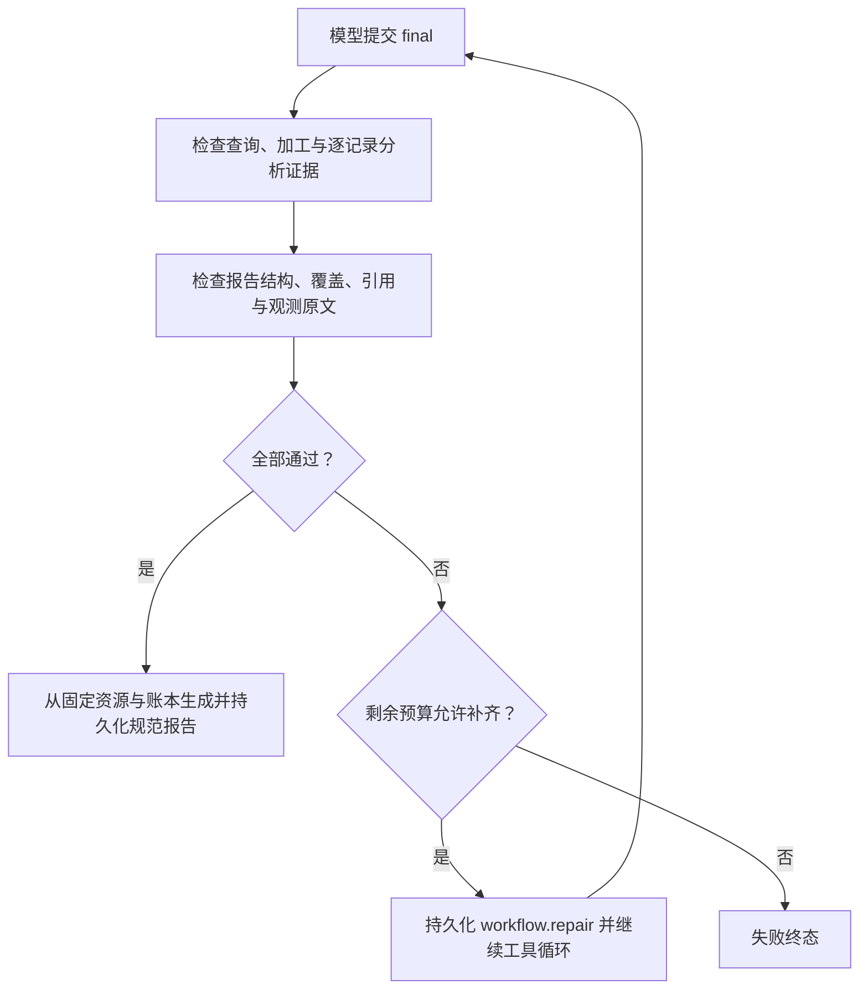

# 必需步骤检查与结构化报告

`WorkflowGuard` 在 final 交付前检查真实查询、加工和单图分析证据，并校验报告结构、记录覆盖与来源引用。缺项通过普通模型和工具循环有限补齐；预算耗尽则失败。数据工具见 [业务数据能力](BUSINESS-DATA.md)，安装配置见 [部署指南](BUSINESS-DEPLOYMENT.md)，开发步骤见教程[执行检查](../../tutorials/src/content/docs/guide/09-workflow-gate.md)与[报告展示](../../tutorials/src/content/docs/guide/10-report-and-citations.md)。

## 业务包与生效范围

资源由 manifest 声明 `role=resource`，参与包摘要、签名和 run 固定快照：

| 资源 | 契约 |
| --- | --- |
| `workflow-requirements.json` | version 固定字符串 `1`；maxRepairs 为 0～2；pipelines 为 1～8 条路线，id、connectorId 各自唯一，每个声明的 connector 恰好一条路线 |
| `report-requirements.json` | version 为字符串 `1`，format 为 `evidence-report-v1`；rules 最多 8 条唯一规则，每条仅含 id/path/sha256，绑定包内真实规则文件及原始字节摘要 |
| `report-submission.schema.json` | 平台内置 schema 的副本，规范摘要须与 [正式 schema](../service-harness-skill/contracts/report-submission.schema.json) 一致，不能自行放宽 |

工作流配置示例：

```json
{
  "version": "1", "maxRepairs": 2,
  "pipelines": [{
    "id": "patrol-http", "connectorId": "patrol-records",
    "processingProfileId": "patrol-summary", "analysisProfileIds": ["describe"]
  }]
}
```

processingProfileId 必须存在于 data-processing.json 且 connectorId 一致；analysisProfileIds 是 analysis-profiles.json 中最多 8 个唯一 ID，每条加工后记录均须完成每个必需 profile。空列表只要求查询与加工。字段集严格校验；HTTP 与上传是可选入口，开始多个查询范围后每个范围均须完成。

检查对象是本 run 已激活的业务 release。创建任务应显式选择业务 skills 及依赖；仅候选、未激活的技能不强制执行。SKILL 正文须说明显式读取资源与提交要求，旁文件不会自动加载。改规则后须更新规则摘要、升业务包版本并重新签名。

## 服务端证据检查

证据来自 ProviderStore 与作业、调用账本联查，要求作业 `actual_finished=1`、`effect_status=completed`，调用 confirmed 且标准结果 `status=success`。按当前租户、用户、run 与固定业务技能隔离；模型自述、伪造引用、执行意图、失败与 unknown 不作为完成证据。

| 步骤 | 必须成立的证据 |
| --- | --- |
| 查询 | `common.data.query.v1` 的 data-page；按 connectorId/queryHash/snapshotId 分组，无缺页或页内容冲突 |
| 加工 | `common.processing.process.v1` 的 data-set；profileHash 匹配固定配置、coverage.queryComplete=true、pageRefs 真实且覆盖该范围全部已观察页位置 |
| 分析 | `common.capability.invoke.v1` 的 analysis；mediaRef 来自加工记录 sources，profileId/hash 匹配固定配置 |

重复查询按稳定页位置核对；多个等价完整 dataset 可选择有齐全分析证据的一个，不能以另一范围的完整查询遮盖缺页。精确去重记录可选任一真实来源，不同记录即使引用同图仍分别完成。空查询仍须查全并加工，随后无需图片分析。HTTP 授权在交付时重查，撤权拒绝交付。

`result.result.workflow` 包含 satisfied 与各技能检查结果，记录 release、requirementsDigest、queryScopes、processedRecords、requiredAnalyses、confirmedAnalyses、missingCount、missing。反馈最多列 32 条缺项，完整 missingCount 决定是否通过。常见 code 为 QUERY_REQUIRED、QUERY_INCOMPLETE、PROCESS_REQUIRED、ANALYSIS_REQUIRED、QUERY_PAGE_CONFLICT；加工和分析缺项附真实 pageRefs、datasetRef、recordId、mediaRef。

## 模型提交与规范报告

声明报告要求的技能仍使用现有 model-decision：`kind=final`、`text=纯 JSON 字符串`，不加 Markdown 或额外字段。提交示例：

```json
{"schemaVersion":1,"reports":[{"skill":"fhe/patrol-tutorial","summary":"资料概述","limitations":["实际限制"],"datasets":[{"datasetRef":"真实datasetRef","findings":[{"recordIndex":0,"profileId":"describe","mediaRef":"该记录sources里的真实mediaRef","observation":"原样复制已确认answer","assessment":{"status":"not-assessed","reason":"未作正常或异常判断","ruleIds":[]}}]}]}]}
```

reports 恰好覆盖本 run 已激活且声明报告要求的技能，datasets 恰好对应检查选定的完整加工结果。每条记录、每个必需 profile 均有 finding；recordIndex 是完整 records 中零起始下标，分页后不重置，相同 recordIndex/profileId 不可重复。引用缺失、重复、额外或属于其他 run 均不通过。

observation 须逐字等于对应已确认分析的 answer。模型不提交统计、时间、来源产物标识、人数或置信度等派生字段。assessment.status 只允许 not-assessed、review-required、normal、abnormal；normal/abnormal 须引用获准 ruleIds。summary 与 assessment.reason 为模型生成内容，规则摘要正确不代表其语义判断已获证明。



成功结果 `result.result.report` 为 `{schemaVersion:1,format:"evidence-report-v1",reports:[...]}`。每个报告含 skill、release、requirementsDigest、summary、summarySemanticallyVerified=false、limitations、datasets。`result.result.text` 是同一规范报告的 JSON 文本镜像，前端须按结构展示。

| 输出位置 | 服务端补入的事实 |
| --- | --- |
| datasets[].datasetRef/recordCount/coverage/stats/groups/warnings | 已确认加工事实；recordCount 是记录数，不是人数 |
| findings[].recordIndex/record | 完整加工记录与下标，未知 capturedAt 保持 null |
| findings[].observation/payloadJson/warnings | 已确认能力原始返回，不合成 count/confidence |
| findings[].citation | analysisRef、profileId/hash、analysisResultSha256、媒体 ID/版本/类型/摘要、captureTimeTrust、artifactId/artifactSha256 |
| findings[].assessment | status/reason、固定规则 ruleRefs 与 semanticallyVerified=false |

前端按真实 artifactId/hash 关联已确认来源，再按当前用户、run/artifact 权限和固定原图版本展示；可使用 [render-report.js](../../tutorials/examples/render-report.js)。服务器交付前执行 source 授权与 checkDelivery。重启读取已持久化的同一报告，不重新推理或生成报告。

## 预算、失败与兼容

final.text UTF-8 上限 64 KiB；最多 8 个技能、每技能 64 个 dataset、每 dataset 1024 个 finding，recordIndex≤1023。summary/observation 各≤4096 字符，reason≤2048 字符。规范报告上限 256 KiB，超限为 `REPORT_RESULT_LIMIT`，不截断记录；实际还受模型输出和上下文预算约束。

工作流、报告与模型格式修复共享 executionLimits.maxRepairs；补齐次数取业务 maxRepairs 与宿主 workflow.max.repairs 的较小值，最多两次，并消耗 maxRounds、maxTools、maxLifetimeMillis。workflow.repair 在 run 租约/fence/version 下提交，同一 final round 幂等；重启不重置计数，中断恢复不重复扣次。补齐不会重放 unknown 调用。

仅声明工作流的包在缺项耗尽后报 `WORKFLOW_REQUIREMENTS_UNMET`；声明报告要求的包报 `REPORT_REQUIREMENTS_UNMET`，包括尚缺必需步骤的情况。报告反馈 code 包括 REPORT_FORMAT_INVALID、REPORT_SKILL_SET_INVALID、REPORT_CITATION_INVALID、REPORT_OBSERVATION_MISMATCH、REPORT_FINDINGS_INCOMPLETE、REPORT_DATASETS_INCOMPLETE、REPORT_RULE_REQUIRED、REPORT_RULE_INVALID。权限、配置、交付与尺寸错误保留各自错误码。

没有 workflow/report 要求的旧包保留相应原 final 行为；宿主缺 guard 报 `WORKFLOW_GUARD_UNAVAILABLE`，guard 不支持报告报 `REPORT_GUARD_UNAVAILABLE`，报告资源/规则/schema 错误报 `REPORT_CONFIG_INVALID`。先部署匹配的核心、技能 JAR 与 guard，再发布要求这些能力的业务包；已有 run pin 不迁移。

检查保证完成证据、结构和引用符合配置。用户问题范围、视觉识别质量、summary/reason 与业务规则的语义一致性仍需业务判断；不能把 semanticallyVerified=false 显示为“已验证正常”，也不能以当前时间补拍摄时间。
